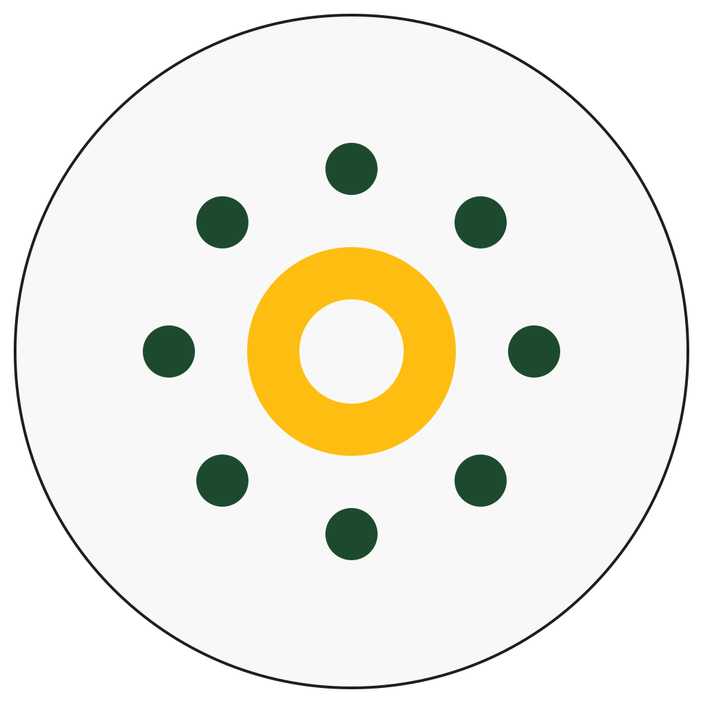
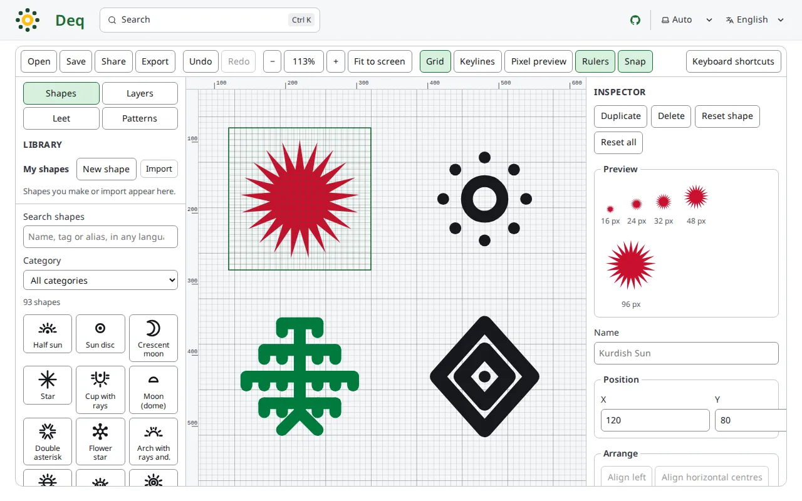

<div align="center">



# Deq · دەق

**Traditional Kurdish tattoo shapes as an open, parametric design system.**

[](https://github.com/kanilabs/deq/actions/workflows/ci.yml)
[](https://github.com/kanilabs/deq/actions/workflows/codeql.yml)
[](https://scorecard.dev/viewer/?uri=github.com/kanilabs/deq)
[](LICENSE)

</div>

> **Status: pre-alpha (Phase 11 of 14).** The shape spec, renderers in TypeScript, Python and Rust, 23 export formats, icon packages, fonts, the CLIs, the website with the Studio, Deq Leet, the pattern generator, the story and the showcase are in place. Packages are not published yet. See the [roadmap](#roadmap).

**Website:** [kanilabs.github.io/deq](https://kanilabs.github.io/deq/) · **Docs:** [docs/](docs/index.md)

<picture>
  <source media="(prefers-color-scheme: dark)" srcset="apps/site/public/screens/studio-en-dark.webp" />
  
</picture>

## Table of contents

- [What is Deq?](#what-is-deq)
- [What Deq provides](#what-deq-provides)
- [Documentation](#documentation)
- [Packages](#packages)
- [Repository layout](#repository-layout)
- [Development](#development)
- [Roadmap](#roadmap)
- [Contributing](#contributing)
- [Security](#security)
- [License](#license)

## What is Deq?

Deq (Kurdish: دەق, also called _xal_) is the traditional tattoo art of the Kurds. Its geometric symbols (sun, moon, stars, combs, chevrons, diamonds, dots, trees) have been worn on faces and hands across Kurdistan and Mesopotamia for centuries. This project documents that history, with sources, and turns the symbols into a precise, open design system.

## What Deq provides

- A canonical, documented **shape specification** with construction maths for every shape.
- **Studio**: a responsive canvas editor to customise and export shapes (SVG, layered SVG, PDF, AI, PSD, PNG, JPG, favicon, JSX and more).
- **Icon packages** for React, Vue, Svelte, web components and plain SVG.
- **Fonts**: static, variable and color icon fonts, plus a Deq Leet font.
- **Libraries and a `deq` CLI** in TypeScript, Python and Rust, with identical output.
- **Deq Leet**: write text in Deq shapes, leetspeak-style.
- The **Kurdish flag** and **Kurdish Sun** with exact colors, geometry and generators.
- A **story** of Deq with every source cited, in English, Sorani and Kurmanji.

## Documentation

The guides live in [`docs/`](docs/index.md) and are published on the website in English, Sorani and Kurmanji (the translations are drafts awaiting native review).

- **Using Deq:** [getting started](docs/guide/getting-started.md), [the Studio](docs/guide/studio.md), [exporting](docs/guide/exporting.md), [custom shapes](docs/guide/custom-shapes.md), [Deq Leet](docs/guide/leet.md), [pattern generator](docs/guide/generate.md), [the flag](docs/guide/flag.md), [fonts](docs/guide/fonts.md), [install and offline use](docs/guide/pwa.md).
- **Developers:** [packages](docs/dev/packages.md), [command line](docs/dev/cli.md), [development setup](docs/dev/setup.md), [architecture](docs/dev/architecture.md), [codegen](docs/dev/codegen.md), [shape spec](docs/dev/spec.md), [adding a shape](docs/dev/adding-a-shape.md), [writing an exporter](docs/dev/exporters.md), [font pipeline](docs/dev/fonts.md), [testing](docs/dev/testing.md), [releasing](docs/dev/releasing.md), [security](docs/dev/security.md), [architecture decisions](docs/decisions/).
- **API reference:** [core](docs/api/core.md), [exporters](docs/api/exporters.md), [generator](docs/api/generator.md), [icons](docs/api/icons.md), [React](docs/api/react.md), [Vue](docs/api/vue.md), [Svelte](docs/api/svelte.md), [elements](docs/api/elements.md), [CLI package](docs/api/cli.md), [`deq` commands](docs/api/commands.md), [Python](docs/api/python.md), [Rust](docs/api/rust.md).
- **Design:** [shape spec](docs/design/shape-spec.md), [Deq Leet tables](docs/design/leet.md), [fonts](docs/fonts/README.md).

## Packages

| Registry  | Package                                                                                            | Status      |
| --------- | -------------------------------------------------------------------------------------------------- | ----------- |
| npm       | `@0xdolan/deq-core`                                                                                | Unreleased  |
| npm       | `@0xdolan/deq-icons`, `-react`, `-vue`, `-svelte`, `-elements`, `-exporters`, `-generator`, `-cli` | Placeholder |
| PyPI      | `deq-shapes`                                                                                       | Placeholder |
| crates.io | `deq-shapes`, `deq-cli` (binary: `deq`)                                                            | Placeholder |

## Repository layout

| Path                                 | Contents                                                    |
| ------------------------------------ | ----------------------------------------------------------- |
| [`packages/`](packages/)             | TypeScript packages (npm)                                   |
| [`python/`](python/)                 | Python package (PyPI)                                       |
| [`rust/`](rust/)                     | Rust crates (crates.io)                                     |
| [`apps/site/`](apps/site/)           | Website and Studio (GitHub Pages)                           |
| [`docs/`](docs/)                     | Documentation and [architecture decisions](docs/decisions/) |
| [`.github/`](.github/)               | CI/CD workflows, templates                                  |
| [`.claude/skills/`](.claude/skills/) | Reusable AI skills for working with Deq                     |

## Development

Requirements: Node 24 with pnpm (via Corepack), Python ≥ 3.12 with [uv](https://docs.astral.sh/uv/), Rust (via rustup; the version is pinned in `rust-toolchain.toml`), [just](https://just.systems/), [gitleaks](https://github.com/gitleaks/gitleaks), [actionlint](https://github.com/rhysd/actionlint) and [cargo-deny](https://github.com/EmbarkStudios/cargo-deny). Docker is optional.

```sh
just setup      # install dependencies, enable git hooks
just ci         # run every CI check locally
just docker-ci  # run CI in a clean container
just --list     # all tasks
```

Full guide: [docs/dev/setup.md](docs/dev/setup.md).

## Roadmap

| Phase | Scope                                  | Status |
| ----- | -------------------------------------- | ------ |
| 0     | Foundation and security baseline       | ✅     |
| 1     | Research and image curation            | ✅     |
| 2     | Shape specification and geometry       | ✅     |
| 3     | Core library                           | ✅     |
| 4     | Exporters                              | ✅     |
| 5     | Icon packages and fonts                | ✅     |
| 6     | Python and Rust ports, CLIs            | ✅     |
| 7     | Website foundation (themes, i18n, PWA) | ✅     |
| 8     | Studio                                 | ✅     |
| 9     | Deq Leet and pattern generator         | ✅     |
| 10    | Story, sources and showcase            | ✅     |
| 11    | Documentation and screenshots          | 🚧     |
| 12    | Branding and marketing                 | ⏳     |
| 13    | Packaging and v1.0.0                   | ⏳     |
| 14    | Final audit and hardening              | ⏳     |

## Contributing

Read [CONTRIBUTING.md](CONTRIBUTING.md) and the [Code of Conduct](CODE_OF_CONDUCT.md). The project uses gitflow: work on `feature/*` branches off `develop`.

## Security

Please report vulnerabilities privately. See [SECURITY.md](SECURITY.md).

## License

[GPL-3.0-or-later](LICENSE) © 0xdolan
