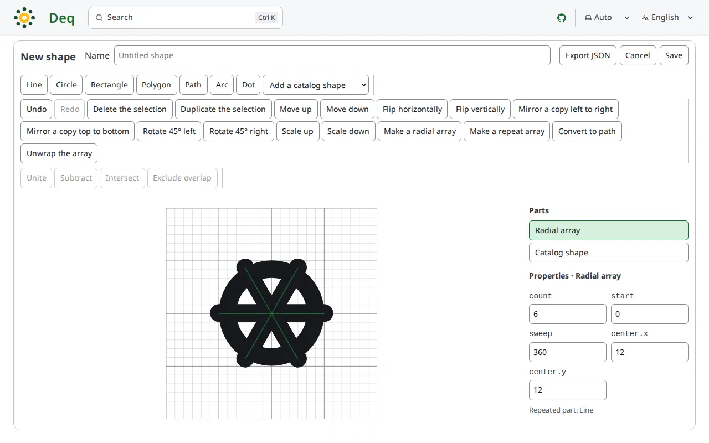

> ئەم دەقە ڕەشنووسە و هێشتا پێویستی بە پێداچوونەوەی ئاخێوەرانی سۆرانی هەیە. ڕاستکردنەوەکان لە [لیستی کێشەکان](https://github.com/kanilabs/deq/issues) بەخێربێن.

جگە لە کەتەلۆگ، ستۆدیۆ **شێوەکانم** دەپارێزێت: ئەو نەخشانەی لە دەستکاریکەری شێوەدا دەیانکێشیت یان لە فایلێکەوە هاوردەیان دەکەیت. لەسەر تابلۆ، لە پشکنەر و لە هەموو هەناردنێکدا وەک شێوەکانی کەتەلۆگ کار دەکەن.

<picture>
  <source media="(prefers-color-scheme: dark)" srcset="../../../apps/site/public/screens/shape-editor-en-dark.webp" />
  
</picture>

## دروستکردنی شێوەیەک

1. لە تابی **شێوەکان**، **شێوەی نوێ** لە تەنیشت **شێوەکانم** هەڵبژێرە.
2. **ناو**ێکی بدەیێ.
3. بە دوگمەکانی ژێر **زیادکردنی بەش** بەش زیاد بکە: **هێڵ**، **بازنە**، **لاکێشە**، **فرەگۆشە**، **ڕێڕەو**، **کەوان** و **خاڵ**. **زیادکردنی شێوەیەک لە کەتەلۆگ** هەر شێوەیەکی دەق وەک بەشێک زیاد دەکات.
4. بەشەکان لەسەر تۆڕەکە ڕابکێشە بۆ جووڵاندنیان، یان ژمارەکانیان لە ژێر **تایبەتمەندییەکان** دابنێ. **ڕەنگکردن** **هێڵ** یان **پڕکردنەوە** هەڵدەبژێرێت.
5. **پاشەکەوتکردن** هەڵبژێرە. شێوەکە لە شێوەکانم دەردەکەوێت؛ **هەڵوەشاندنەوە** دەستکاریکەرەکە بێ پاشەکەوتکردن دادەخات.

تۆڕەکە ٢٤ لە ٢٤ یەکەیە، وەک هەموو شێوەیەکی دەق، و بەشەکان دەبێت لە ناویدا بمێننەوە. شێوەیەک دەتوانێت تا ٦٤ بەشی هەبێت.

## هەڵبژاردن و گۆڕینی بەشەکان

- کلیک لە بەشێک، یان ڕیزەکەی لە ژێر **بەشەکان**، بکە بۆ هەڵبژاردنی. Shift و کلیک چەند دانەیەک هەڵدەبژێرێت؛ Ctrl+A هەموو (لە ماک ⌘).
- کلیلەکانی تیر هەڵبژاردە نیو یەکە دەجووڵێنن، Shift و تیر ٢ یەکە.
- Ctrl+D دووانە دەکات، Delete لای دەبات، Ctrl+Z و Ctrl+Shift+Z دەگەڕێننەوە و دووبارە دەکەنەوە. Escape هەڵبژاردە لادەبات، یان کاتێک هیچ هەڵنەبژێردراوە دەستکاریکەرەکە دادەخات.

ئامرازەکانی شێوە لەسەر هەڵبژاردە کار دەکەن:

- **بۆ سەرەوە**، **بۆ خوارەوە**: ڕیزی کێشان.
- **هەڵگەڕاندنەوەی ئاسۆیی**، **هەڵگەڕاندنەوەی ستوونی**؛ **کۆپییەکی ئاوێنەیی لە چەپەوە بۆ ڕاست** و **کۆپییەکی ئاوێنەیی لە سەرەوە بۆ خوارەوە** کۆپییەکی ئاوێنەیی زیاد دەکەن، کە لەگەڵ هاوسەنگیی زۆربەی نەخشەکانی دەق دەگونجێت.
- **سووڕاندن ٤٥° بۆ چەپ**، **سووڕاندن ٤٥° بۆ ڕاست**، **گەورەکردن**، **بچووککردنەوە**.
- **دروستکردنی ڕیزی بازنەیی** بەشەکە بە دەوری ناوەڕاستدا دووبارە دەکاتەوە، وەک تیشکەکانی خۆر؛ **دروستکردنی ڕیزی دووبارە** لە ڕیزێکدا دووبارەی دەکاتەوە. **هەڵوەشاندنەوەی ڕیز** ڕیزەکە دەگەڕێنێتەوە بۆ بەشەکەی.
- **گۆڕین بۆ ڕێڕەو** بەشێک دەکاتە ڕێڕەوێک کە خاڵ بە خاڵ دەستکاری دەکرێت.

## دەستکاریکردنی ڕێڕەو

ڕێڕەوێک هەڵبژێرە بۆ بینینی خاڵەکانی وەک دەسک لەسەر تۆڕەکە. دەسکێک ڕابکێشە بۆ جووڵاندنی، یان کلیکی لێ بکە بۆ هەڵبژاردنی، پاشان:

- **زیادکردنی خاڵێک دوای خاڵی هەڵبژێردراو**،
- **سڕینەوەی خاڵی هەڵبژێردراو**،
- **چەماندن یان ڕاستکردنەوەی پارچەکە**،
- **کردنەوە یان داخستنی ڕێڕەو**.

داتای ڕێڕەوەکە وەک دەقیش لە ژێر **داتای ڕێڕەو** پیشان دەدرێت، کە دەتوانیت تێیدا بنووسیت یان بیلکێنیت.

## تێکەڵکردنی بەشەکان

دوو بەشی داخراو یان زیاتر هەڵبژێرە (بازنە، لاکێشە، فرەگۆشە یان ڕێڕەوی داخراو) و **یەکخستن**، **لێدەرکردن**، **یەکتربڕین** یان **دەرکردنی بەشی هاوبەش** هەڵبژێرە. ئەنجامەکە یەک ڕێڕەوە. بەشی کراوە وەک هێڵ تێکەڵ ناکرێن.

## بەکارهێنان، هەناردن و سڕینەوە

- کلیک لە شێوەیەک لە شێوەکانم بکە، یان ڕایبکێشە، بۆ زیادکردنی بۆ تابلۆ.
- دوگمەکانی سەر هەر شێوەیەک دەستکاری دەکەن (✎)، وەک spec JSON دایدەگرن (⤓) یان دەیسڕنەوە (✕). کۆپییە دانراوەکان دوای وەشانی پاشەکەوتکراو دەکەون. ئەو دیزاینانەی شێوەیەکی سڕاوە بەکاردەهێنن کۆپیی خۆیان دەپارێزن.
- **هاوردەکردن** فایلی spec JSON دەخوێنێتەوە، وەک یەکێک کە لێرەوە هەناردە کراوە یان فایلێک لە `spec/shapes/` ی ڕیپۆکە.

شێوەکانم لەم وێبگەڕەدا هەڵدەگیرێت و تا ١٠٠ شێوە دەگرێت. دیزاینی پاشەکەوتکراو و بەستەری هاوبەشکراو ئەو شێوە تایبەتانە لەگەڵ خۆیان دەبەن کە بەکاریان دەهێنن، بۆیە لەسەر هەر کۆمپیوتەرێک دەکرێنەوە.

## هاوردەکردنی SVG

**کردنەوە** لە ئامرازەکان فایلێکی SVG (تا ٢٥٦ کیلۆبایت) دەخوێنێتەوە و بۆ شێوەکانم زیادی دەکات. ستۆدیۆ وێنەکە لە شێوە و ڕێڕەوەکانییەوە دووبارە دروست دەکاتەوە و هەموو شتێکی تر لادەبات: گرادیەنت، دەق، وێنە، فلتەر، سکریپت و بەستەر. ئاگادارییەک دەڵێت کەی شتێک لابراوە. وێنەی زۆر ورد لەوانەیە ڕەت بکرێنەوە.

بۆ باشترین ئەنجام، لەسەر تابلۆیەکی ٢٤ × ٢٤ بە هێڵ و پڕکردنەوەی سادە بکێشە.

## دواتر

- [هەناردن](exporting.md)ی شێوەکانت.
- بۆ پێشنیازکردنی شێوەیەک بۆ کەتەلۆگ، وەک spec JSON هەناردەی بکە و [کێشەیەک](https://github.com/kanilabs/deq/issues) بە سەرچاوەکەیەوە بکەرەوە.
