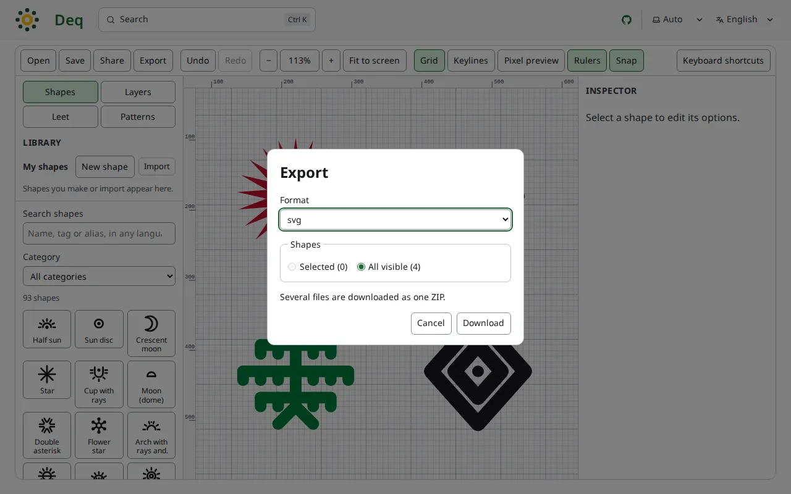

> ئەم دەقە ڕەشنووسە و هێشتا پێویستی بە پێداچوونەوەی ئاخێوەرانی سۆرانی هەیە. ڕاستکردنەوەکان لە [لیستی کێشەکان](https://github.com/kanilabs/deq/issues) بەخێربێن.

**هەناردن** لە ئامرازەکانی ستۆدیۆ (Ctrl+E، یان ⌘E لە ماک) شێوەکانی سەر تابلۆ بە هەر یەک لە ٢٣ فۆرمات دادەگرێت. هەر شێوەیەک بەو هەڵبژاردانەوە هەناردە دەکرێت کە لە پشکنەردا پێت داوە.

<picture>
  <source media="(prefers-color-scheme: dark)" srcset="../../../apps/site/public/screens/studio-export-en-dark.webp" />
  
</picture>

## هەنگاوەکان

1. ئەو شێوانە هەڵبژێرە کە دەتەوێت هەناردەیان بکەیت، یان هیچ هەڵمەبژێرە بۆ هەناردنی هەموویان.
2. **هەناردن** هەڵبژێرە، پاشان **فۆرمات**ێک.
3. لە ژێر **شێوەکان**، **هەڵبژێردراو** یان **هەموو دیارەکان** هەڵبژێرە. شێوەی شاراوە هەرگیز هەناردە ناکرێت.
4. بۆ PNG، JPG، WebP، AVIF و PSD، یەک یان چەند **قەبارە**یەک (١× تا ٤×) دیاری بکە.
5. **داگرتن** هەڵبژێرە.

هەر شێوەیەک دەبێتە فایلێکی جیا، بە ناوی **ناو**ی شێوەکە لە پشکنەر، یان ناسنامەکەی (`kurdish-sun.svg`). شێوەی دووەم بە هەمان ناو ژمارەیەک وەردەگرێت (`kurdish-sun-2.svg`). چەند فایلێک پێکەوە وەک `deq-export.zip` دادەگیرێن. قەبارەی گەورەتر `@2x`، `@3x` و هتد بۆ ناوەکە زیاد دەکات.

## فۆرماتەکان

| گرووپ      | فۆرمات               | چی وەردەگریت                                                                                                |
| ---------- | -------------------- | ----------------------------------------------------------------------------------------------------------- |
| **ڤێکتەر** | SVG                  | شێوەکە وەک فایلێکی بچووکی SVG.                                                                              |
|            | Layered SVG          | SVGێک بە چینێکی Inkscape بۆ هەر چینێکی شێوە.                                                                |
|            | SVG sprite           | `deq-sprite.svg`، یەک `<symbol>` بۆ هەر شێوەیەک، بۆ ئاماژەی `<use>`.                                        |
|            | PDF                  | PDFی ڤێکتەر؛ شێوەی چینچین چینەکانی وەک چینی PDF دەپارێزێت.                                                  |
|            | AI                   | فایلێکی Illustrator ی گونجاو لەگەڵ PDF بە هەمان چینەکان.                                                    |
|            | EPS                  | EPS 3.0 بۆ ڕێگاکانی چاپی کۆنتر.                                                                             |
| **ڕاستەر** | PNG، JPG، WebP، AVIF | وێنە بە هەر قەبارەیەک. JPG باکگراوندی سپی هەیە.                                                             |
|            | ICO                  | ئایکۆنی Windows بە وێنەی ١٦، ٣٢ و ٤٨ پیکسڵ.                                                                 |
|            | Favicon              | کۆمەڵە فاڤیکۆنێک بۆ ماڵپەڕ: `favicon.ico`، `favicon.svg`، ئایکۆنەکانی Apple و Android و `site.webmanifest`. |
|            | PSD                  | فایلێکی Photoshop بە چینێکی پیکسڵ بۆ هەر چینێکی شێوە.                                                       |
| **کۆد**    | HTML                 | پارچەیەکی SVG ی ناو دێڕ.                                                                                    |
|            | JSX، TSX             | پێکهاتەیەکی React.                                                                                          |
|            | Vue، Svelte          | پێکهاتەیەکی تاکە فایل.                                                                                      |
|            | Data URI             | SVG وەک بەستەرێکی `data:` لە فایلێکی دەقیدا.                                                                |
|            | CSS background       | پۆلێکی CSS بە SVG وەک `background-image`.                                                                   |
|            | CSS mask             | پۆلێکی CSS کە بە SVG دەیپۆشێت، بۆیە شێوەکە ڕەنگی دەق وەردەگرێت.                                             |
| **داتا**   | Figma                | SVGێک بە گرووپی ناودار و ڕەنگی جێگیر، ئامادە بۆ هاوردەکردن بۆ Figma.                                        |
|            | Spec JSON            | شێوەکە بە فۆرماتی خودی دەق، بۆ کردنەوەی دووبارە لە ستۆدیۆ یان زیادکردنی بۆ کەتەلۆگ.                         |

ئەو فۆرماتانەی تەنها یەک شێوەی چوارگۆشە وەردەگرن (SVG sprite، ICO، فاڤیکۆن، Figma و spec JSON) بۆ دەقی لیت و نەخشەکان پێشکەش ناکرێن، کە وەک یەک دیمەن هەناردە دەکرێن. بڕوانە [لیتی دەق](leet.md) و [دروستکەری نەخش](generate.md).

## کردنەوەی فایلەکان

- **Inkscape** 1.4 و نوێتر چینەکانی Layered SVG، PDF و AI پیشان دەدات.
- **Illustrator** فایلی AI و PDF بە چینێک بۆ هەر چینێکی شێوە دەکاتەوە.
- **Photoshop** فایلی PSD بە چینێکی پیکسڵ بۆ هەر چینێکی شێوە دەکاتەوە.
- **Figma**: SVG ی Figma هاوردە بکە، یان SVGێک بلکێنە.

## بێ ئینتەرنێت

فایلەکانی PNG، JPG، WebP، AVIF، ICO، فاڤیکۆن و PSD بە مۆدیولێکی WebAssembly دەکێشرێن کە لە یەکەم هەناردنی ڕاستەردا بار دەبێت. بۆ بەکارهێنانی بێ ئینتەرنێت هەڵناگیرێت، بۆیە هەناردنی ڕاستەر پێویستی بە ئینتەرنێتە. بڕوانە [دامەزراندن و بەکارهێنانی بێ ئینتەرنێت](pwa.md).

## بێ ستۆدیۆ

فەرمانی `deq` بۆ Node.js و پاکێجی `@0xdolan/deq-exporters` هەمان فایلەکان دروست دەکەن؛ ئامرازەکانی Python و Rust ـیش SVG، Layered SVG، SVG sprite، PDF، PNG، JPG، WebP و ICO هەناردە دەکەن. بڕوانە [هێڵی فەرمان](../../dev/cli.md) و [پاکێجەکان](../../dev/packages.md).
