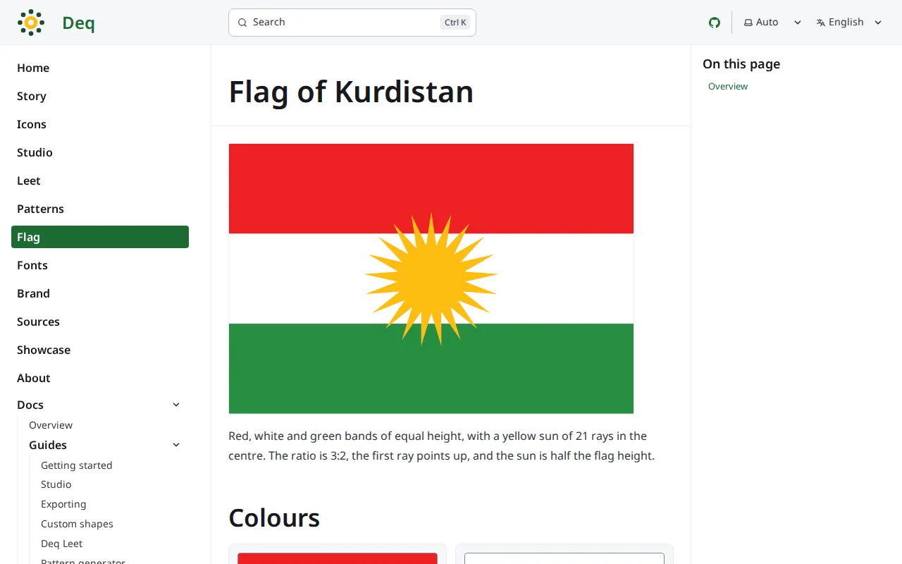

> ئەم دەقە ڕەشنووسە و هێشتا پێویستی بە پێداچوونەوەی ئاخێوەرانی سۆرانی هەیە. ڕاستکردنەوەکان لە [لیستی کێشەکان](https://github.com/kanilabs/deq/issues) بەخێربێن.

پەڕەی [ئاڵا](https://kanilabs.github.io/deq/ckb/flag/) ئاڵای کوردستان بەپێی پێوەرەکەی دەکێشێت: سێ پشتێنی سوور، سپی و سەوز بە بەرزیی یەکسان، و خۆرێکی زەرد بە ٢١ تیشک لە ناوەڕاستدا. ڕێژەکە ٣:٢ ـە، یەکەم تیشک ڕووی لە سەرەوەیە، و خۆرەکە نیوەی بەرزیی ئاڵاکەیە.

<picture>
  <source media="(prefers-color-scheme: dark)" srcset="../../../apps/site/public/screens/flag-en-dark.webp" />
  
</picture>

## لەسەر پەڕەکە

- **ڕەنگەکان**: سوور، سپی، سەوز و زەرد، هەر یەکە بە hex، RGB و CMYK.
- **جیاوازیی ڕەنگ**: ڕێژەی جیاوازیی هەموو جووتێک لە ڕەنگەکانی ئاڵا. هیچ جووتێک ناگاتە ٤.٥:١ کە دەقی ئاسایی پێویستییەتی، بۆیە دەقی ڕەش یان سپی لەسەر ڕەنگەکانی ئاڵا دابنێ.
- **جۆرەکان**: ڕەنگی تەواو، ڕەشی تاکڕەنگ، سپیی تاکڕەنگ، هێڵی دەرەوە، جیاوازیی بەرز و چوارگۆشە.

هەرگیز ڕەنگی ئاڵاکە مەگۆڕە، مەیکێشە و ژمارەی تیشکەکانی مەگۆڕە.

## وەرگرتنی ئاڵاکە

- **ستۆدیۆ**: لە کتێبخانەی [ستۆدیۆ](studio.md) بگەڕێ بۆ «flag» یان «ئاڵا»، **ئاڵای کوردستان** بۆ تابلۆ زیاد بکە و بە هەر فۆرماتێک [هەناردەی بکە](exporting.md).
- **هێڵی فەرمان**: `deq flag` ئاڵاکە وەک SVG، PNG، JPG یان WebP دەنووسێت.

  ```sh
  deq flag --variant outline --width 1200 --format png --out flag.png
  ```

  `--variant` یەکێکە لە `full-color`، `mono-black`، `mono-white`، `outline`، `high-contrast` و `square`؛ `--width` لە ١ تا ٨١٩٢ پیکسڵە (بە بنەڕەت ٩٠٠). بڕوانە [هێڵی فەرمان](../../dev/cli.md).

- **کۆد**: `renderFlag({ variant, width, title })` لە `@0xdolan/deq-core` SVG ـەکە دەگەڕێنێتەوە. بڕوانە [پاکێجەکان](../../dev/packages.md).

پێوەرەکە، لەگەڵ سەرچاوەکانی، لە [`spec/flag.json`](../../../spec/flag.json) دایە.
