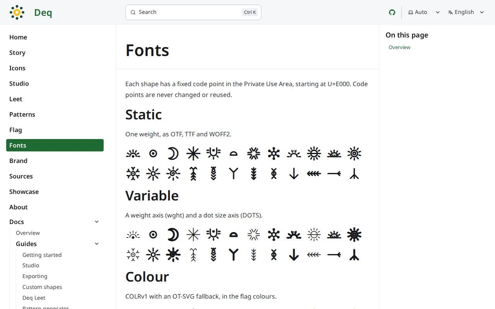

> ئەم دەقە ڕەشنووسە و هێشتا پێویستی بە پێداچوونەوەی ئاخێوەرانی سۆرانی هەیە. ڕاستکردنەوەکان لە [لیستی کێشەکان](https://github.com/kanilabs/deq/issues) بەخێربێن.

دەق دوو خێزانە فۆنتی لەگەڵدایە. **Deq Icons** هەموو شێوەیەکی وەک پیتێک تێدایە، بە وەشانی جێگیر، گۆڕاو و ڕەنگاوڕەنگ. **Deq Leet** پیتەکان وەک نەخشی دەق دەنووسێت. پەڕەی [فۆنتەکان](https://kanilabs.github.io/deq/ckb/fonts/) بە نموونەیەکی زیندوو پیشانیان دەدات.

<picture>
  <source media="(prefers-color-scheme: dark)" srcset="../../../apps/site/public/screens/fonts-en-dark.webp" />
  
</picture>

## کام فۆنت

- **جێگیر**: یەک ئەستووری، بە OTF، TTF و WOFF2. لە هەموو شوێنێک کار دەکات.
- **گۆڕاو**: تەوەرەی ئەستووری (`wght`) و تەوەرەی قەبارەی خاڵ (`DOTS`)، بۆ ئەو بەرنامانەی پشتگیریی فۆنتی گۆڕاو دەکەن.
- **ڕەنگاوڕەنگ**: COLRv1 بە ڕەنگەکانی ئاڵا، لەگەڵ OT-SVG وەک جێگرەوە.
- **Deq Leet**: فۆنتێکی دەقی یەکپانی بۆ لاتینی، کورمانجی و سۆرانی، بە پیتی جێگرەوە لە کۆمەڵە شێوازەکانی `ss01` تا `ss03`. بڕوانە [لیتی دەق](leet.md).

یان Deq Icons ی جێگیر یان گۆڕاو دابمەزرێنە، نەک هەردووکیان، بۆ ئەوەی بەرنامەکان خێزانەکە دوو جار لیست نەکەن.

## داگرتن

فۆنتەکان وەک `deq-fonts-<version>.zip` لە [پەڕەی وەشانەکان](https://github.com/kanilabs/deq/releases) بڵاو دەکرێنەوە. تا یەکەم وەشان، لە ڕیپۆکەوە بە `just fonts` دروستیان بکە؛ لە `fonts/dist/` دەنووسرێن.

## دامەزراندن

- **Linux**: فایلەکانی `.otf` یان `.ttf` بۆ `~/.local/share/fonts/` کۆپی بکە و `fc-cache -f` جێبەجێ بکە. بە `fc-list | grep "Deq"` پشکنینی بکە.
- **macOS**: دوو کلیک لە فایلێکی فۆنت بکە و لە Font Book ـدا **Install Font** هەڵبژێرە، یان فایلەکان بۆ `~/Library/Fonts/` کۆپی بکە.
- **Windows**: کلیکی ڕاست لە فایلەکانی فۆنت بکە و **Install** (یان **Install for all users**) هەڵبژێرە.

ئەو بەرنامانەی کراوە بوون دووبارە بیانکەرەوە، بۆ ئەوەی فۆنتە نوێیەکان ببینن.

## نووسینی شێوەیەک

- **بە ناو**: لەو بەرنامانەی پشتگیریی ligature دەکەن (وەک Figma، Illustrator، Inkscape و LibreOffice)، ناسنامەی شێوەیەک (`roj-half-sun`)، نازناوێک، یان ناوە کورمانجییەکەی بە ASCII (`roj`، `heyv`) بە Deq Icons بنووسە و دەبێتە پیتەکە.
- **بە خاڵی کۆد**: هەر شێوەیەک خاڵی کۆدێکی لە U+E000 ـەوە هەیە، کە لە پەڕەی ئایکۆنەکەیدا وەک **خاڵی کۆدی فۆنت** پیشان دەدرێت و لە [`codepoints.md`](../../fonts/codepoints.md) لیست کراوە. خاڵەکانی کۆد هەرگیز ناگۆڕێن.
- **Deq Leet**: دەقی ئاسایی بنووسە. **لەبەرگرتنەوەی دەقی فۆنت** لە [پەڕەی لیت](https://kanilabs.github.io/deq/ckb/leet/) دەقێک لەبەر دەگرێتەوە کە ڕێک پیتەکانی پێشبینینەکە دەپارێزێت.

## لە ماڵپەڕێکدا

زیپی وەشانەکە `deq-icons.css`، `deq-leet.css` و نەخشەکانی خاڵی کۆدیشی تێدایە (`codepoints.json`، `leet-codepoints.json`). چۆنیەتیی بەکارهێنانیان لە پەڕەیەکدا، و چۆن فۆنتەکان دروست دەکرێن، لە [ڕێنمایی فۆنت](../../fonts/README.md) دایە (بە ئینگلیزی).

## مۆڵەت

فۆنتەکان بە GPL-3.0-or-later لەگەڵ Font Exception مۆڵەت دراون، بۆیە ئەو بەڵگەنامانەی فۆنتەکانیان تێدا جێگیر کراوە پێویست ناکات GPL بن. بڕوانە [`fonts/LICENSE.md`](../../../fonts/LICENSE.md).
