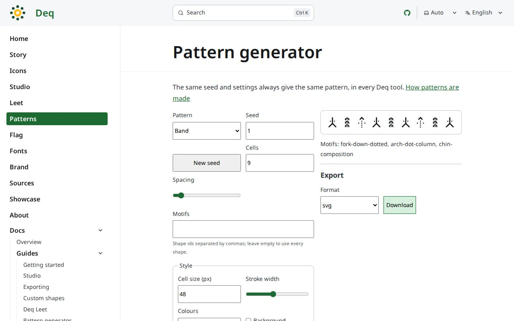

> ئەم دەقە ڕەشنووسە و هێشتا پێویستی بە پێداچوونەوەی ئاخێوەرانی سۆرانی هەیە. ڕاستکردنەوەکان لە [لیستی کێشەکان](https://github.com/kanilabs/deq/issues) بەخێربێن.

دروستکەری نەخش نەخشەکانی دەق لە تۆوێکەوە ڕیز دەکات. هەمان تۆو و ڕێکخستن هەمیشە هەمان نەخش دەدەن، لە ماڵپەڕەکە، پاکێجەکان و هەر سێ ئامرازی هێڵی فەرماندا.

<picture>
  <source media="(prefers-color-scheme: dark)" srcset="../../../apps/site/public/screens/generate-en-dark.webp" />
  
</picture>

## جۆرەکان

- **پشتێن**: ڕیزێک لە ژمارەیەکی تاک لە خانە (٣ تا ٦٣)، ئاوێنەیی بە دەوری ناوەڕاستدا.
- **تۆڕ**: ستوون و ڕیز (هەر یەکە ١ تا ٣٢).
- **گوڵ**: ٣ تا ٢٤ پەڕە کە بە دەوری نەخشێکی ناوەڕاستدا دەسووڕێنەوە.
- **لێوار**: چوارچێوەیەک لە نەخش، هەر لایەک ٣ تا ٣٢ خانە.

**بۆشایی** یەکەی تۆڕ لە نێوان خانەکاندا زیاد دەکات. **نەخشەکان** نەخشەکە بەو ناسنامە شێوانە سنووردار دەکات کە دەینووسیت، بە کۆما یان بۆشایی جیاکراوە. بە بەتاڵی بیهێڵەرەوە بۆ بەکارهێنانی هەموو شێوەکان. پەڕەکە ئەو نەخشانە لیست دەکات کە نەخشەکە بەکاری هێناون.

## پەڕەی نەخش

[پەڕەی نەخش](https://kanilabs.github.io/deq/ckb/generate/) نەخشەکە بە هەمان هەڵبژاردەکانی شێوازی پەڕەی لیت پیشان دەدات و بە هەموو ئەو فۆرماتانەی لەگەڵ دیمەنێک دەگونجێن دایدەگرێت، بە چینێک بۆ هەر خانەیەک. **تۆوی نوێ** تۆوێکی هەڕەمەکی هەڵدەبژێرێت. بینووسەرەوە بۆ دروستکردنەوەی هەمان نەخش.

## لە ستۆدیۆدا

تابی **نەخش** لە [ستۆدیۆ](https://kanilabs.github.io/deq/ckb/studio/) نەخشەکە وەک یەک گرووپ بە بڕگەیەک بۆ هەر خانەیەک بۆ تابلۆ زیاد دەکات.

## لە کۆد و هێڵی فەرماندا

```ts
import { pattern } from "@0xdolan/deq-generator";

const { svg, motifs } = pattern({ kind: "rosette", petals: 12, seed: 7 });
```

```sh
deq generate --kind rosette --petals 12 --seed 7 --out rosette.svg
```
