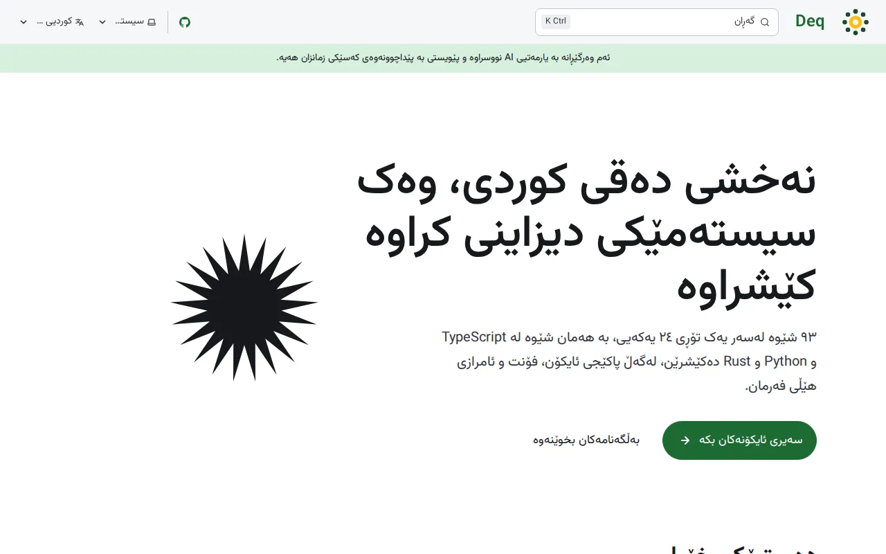
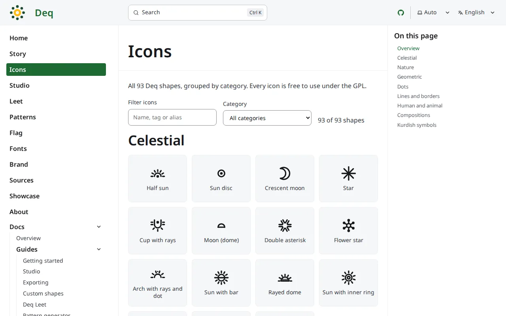
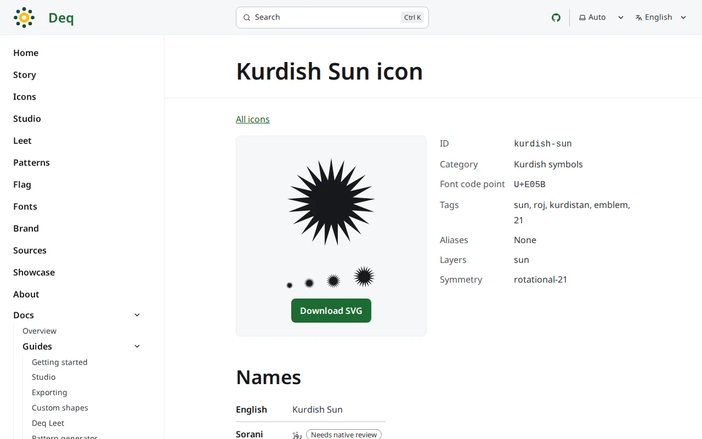

> ئەم دەقە ڕەشنووسە و هێشتا پێویستی بە پێداچوونەوەی ئاخێوەرانی سۆرانی هەیە. ڕاستکردنەوەکان لە [لیستی کێشەکان](https://github.com/kanilabs/deq/issues) بەخێربێن.

دەق نەخشەکانی دەقی کوردیی کۆن دەکاتە ئایکۆن، فۆنت و ئامرازی کراوە. هەموو شتێکی ماڵپەڕەکە بە مۆڵەتی GPL-3.0-or-later بەخۆڕاییە؛ فۆنتەکان «Font Exception»یشیان پێوە زیاد کراوە. ئەم ڕێنماییە پیشانت دەدات لە کوێوە دەست پێ بکەیت.

<picture>
  <source media="(prefers-color-scheme: dark)" srcset="../../../apps/site/public/screens/home-ckb-dark.webp" />
  
</picture>

## دۆزینەوەی نەخشێک

[ئایکۆنەکان](https://kanilabs.github.io/deq/ckb/icons/) بکەرەوە بۆ بینینی هەموو شێوەکان. لە **پاڵاوتنی ئایکۆنەکان** بنووسە بۆ گەڕان بە ناوی ئینگلیزی، کورمانجی یان سۆرانی، تاگ یان نازناو، یان **پۆل**ێک هەڵبژێرە. خانەی گەڕانی سەرەوە (Ctrl+K، یان ⌘K لە ماک) بە هەموو ماڵپەڕەکەدا دەگەڕێت، ڕێنماییەکانیش.

<picture>
  <source media="(prefers-color-scheme: dark)" srcset="../../../apps/site/public/screens/icons-en-dark.webp" />
  
</picture>

هەر شێوەیەک پەڕەی خۆی هەیە: پێشبینین، ناوەکانی بە سێ زمان، تاگەکان، پارامەترەکان و **خاڵی کۆدی فۆنت**، دوگمەی **داگرتنی SVG** و نموونەیەکی **بەکارهێنان**.

<picture>
  <source media="(prefers-color-scheme: dark)" srcset="../../../apps/site/public/screens/icon-en-dark.webp" />
  
</picture>

## بەکارهێنان لە پرۆژەیەکدا

- **لەبەرگرتنەوەی SVG.** **داگرتنی SVG** شێوەکە بە هەڵبژاردە بنەڕەتییەکانی پاشەکەوت دەکات. بۆ گۆڕینی قەبارە، ڕەنگ یان ئەستووری هێڵ، سەرەتا لە [ستۆدیۆ](studio.md) بیکەرەوە.
- **لە کۆددا.** نموونەی **بەکارهێنان** پێکهاتەی React و توخمی `<deq-icon>` پیشان دەدات. پاکێجەکانی React، Vue، Svelte، web components، Python و Rust لە [پاکێجەکان](../../dev/packages.md) دان.
- **وەک فۆنت.** فۆنتی ئایکۆنەکان دابمەزرێنە و ناوی شێوەکە یان خاڵی کۆدەکەی بنووسە. بڕوانە [فۆنتەکان](fonts.md).
- **فۆرماتی زۆر.** ستۆدیۆ PNG، PDF، AI، PSD، JSX و ١٧ فۆرماتی تر هەناردە دەکات. بڕوانە [هەناردن](exporting.md).

## دروستکردنی شتێک

- [ستۆدیۆ](studio.md): شێوەکان لەسەر تابلۆیەک دابنێ، تێکەڵیان بکە و شێوازیان بدەیێ.
- [شێوەی تایبەت](custom-shapes.md): نەخشی خۆت لە بەش و ڕێڕەو بکێشە، یان SVGێک هاوردە بکە.
- [لیتی دەق](leet.md): دەق بە نەخشەکانی دەق بنووسە.
- [دروستکەری نەخش](generate.md): پشتێن، تۆڕ، گوڵ و لێوار لە تۆوێکەوە دروست بکە.
- [ئاڵا](flag.md): ئاڵای کوردستان بەپێی پێوەرەکەی.

## زمان، ڕووکار و بەکارهێنانی بێ ئینتەرنێت

- لیستی زمان لە سەرەوە لە نێوان ئینگلیزی، سۆرانی (کوردی) و کورمانجی (Kurdî) دەگۆڕێت. پەڕە سۆرانییەکان لە ڕاستەوە بۆ چەپن.
- لیستی ڕووکار تاریک، ڕووناک یان ڕێکخستنی سیستەمەکەت هەڵدەبژێرێت.
- ماڵپەڕەکە دوای یەکەم بارکردن بێ ئینتەرنێتیش کار دەکات. بڕوانە [دامەزراندن و بەکارهێنانی بێ ئینتەرنێت](pwa.md).
