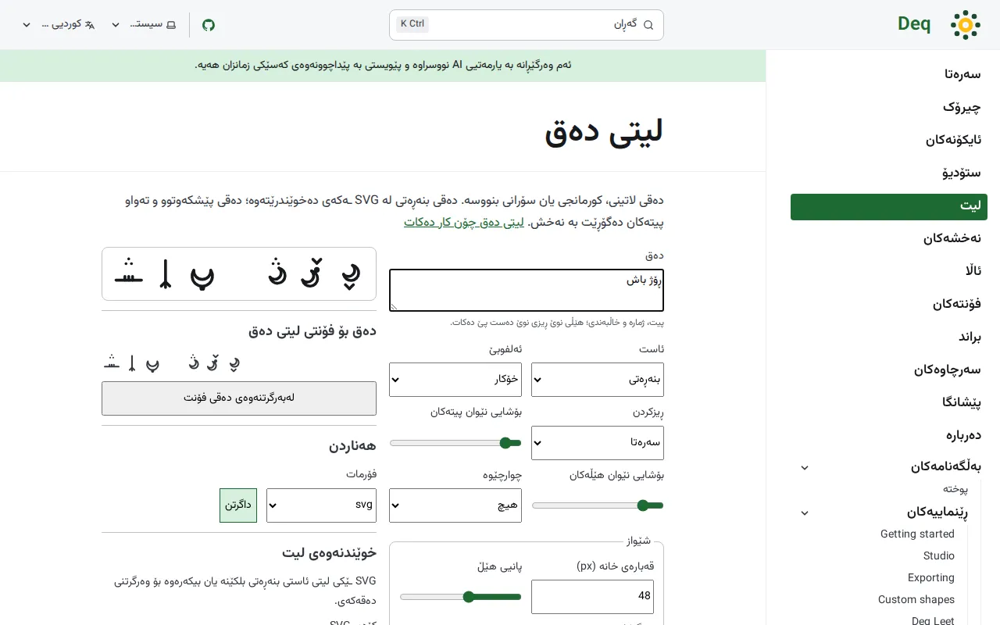

> ئەم دەقە ڕەشنووسە و هێشتا پێویستی بە پێداچوونەوەی ئاخێوەرانی سۆرانی هەیە. ڕاستکردنەوەکان لە [لیستی کێشەکان](https://github.com/kanilabs/deq/issues) بەخێربێن.

لیتی دەق هەر پیت، ژمارە و نیشانەیەکی خاڵبەندی وەک نەخشێکی دەق دەنووسێت. لاتینی، کورمانجی و سۆرانی دەگرێتەوە. هێڵە سۆرانییەکان لە ڕاستەوە بۆ چەپن.

<picture>
  <source media="(prefers-color-scheme: dark)" srcset="../../../apps/site/public/screens/leet-ckb-dark.webp" />
  
</picture>

## ئاستەکان

- **بنەڕەتی**: یەک پیتی خوێندراوە بۆ هەر نووسەیەک. دەقی بنەڕەتی دەتوانرێت لە SVG ـەکەیەوە بخوێندرێتەوە.
- **پێشکەوتوو**: تۆوەکە لە نێوان پیتی بنەڕەتی و جێگرەوەکانیدا هەڵدەبژێرێت، بۆیە هەمان تۆو هەمیشە هەمان دەق دەدات.
- **تەواو**: یەک نەخشی ڕازاندنەوە بۆ هەر نووسەیەک. بۆ خوێندنەوە نییە.

## پەڕەی لیت

لە [پەڕەی لیت](https://kanilabs.github.io/deq/ckb/leet/) دەق بنووسە. پێشبینینەکە دوای هەموو گۆڕانکارییەک دەکەوێت.

- **ئەلفوبێ**: دۆزینەوەی خۆکار، یان بە زۆر لاتینی و کورمانجی، یان سۆرانی.
- **بۆشایی نێوان پیتەکان** و **بۆشایی نێوان هێڵەکان** بە یەکەی تۆڕن (٢٤ یەکە یەک پیتە). **ڕیزکردن** دوای ئاراستەی خوێندنەوە دەکەوێت.
- **چوارچێوە**: هیچ، پشتێنێک لە نەخش لە سەرەوە و خوارەوە، یان لێوارێک بە دەوری دەقەکەدا. **تۆوی چوارچێوە** نەخشەکانی هەڵدەبژێرێت.
- **شێواز**: قەبارەی خانە، پانیی هێڵ، و ڕەنگی دەق، یەک ڕەنگ یان ڕەنگەکانی ئاڵا بە نۆرە. ڕەنگی باکگراوند ئارەزوومەندانەیە.
- **پیشاندانی هێڵە ڕێنماییەکان** سەرەوە و خوارەوەی هەموو هێڵێک دەکێشێت. ڕێنماییەکان هەرگیز هەناردە ناکرێن.
- **لەبەرگرتنەوەی دەقی فۆنت** دەقەکە وەک نووسەی بەکارهێنانی تایبەتی [فۆنتی لیتی دەق](https://kanilabs.github.io/deq/ckb/fonts/) لەبەر دەگرێتەوە. لە شوێنێک بیلکێنە کە ئەو فۆنتە بەکار دێت، ڕێک پیتەکانی پێشبینینەکە پیشان دەدات، جێگرەوەکانیش.
- **داگرتن** بە هەموو ئەو فۆرماتانە هەناردە دەکات کە لەگەڵ دیمەنێک دەگونجێن، بە چینێک بۆ هەر نووسەیەک لە Layered SVG، PDF، AI و PSD. ICO، فاڤیکۆن، sprite، Figma و spec JSON پێشکەش ناکرێن.
- **خوێندنەوەی لیت** SVG ی ئاستی بنەڕەتی، لکێنراو یان لە فایلێکەوە، وەردەگرێت و دەقەکەی دەداتێ.

دەقی هاتوو دەقی سادەیە، لانیزۆر ١٬٠٢٤ نووسە، ٢٥٦ پیت و ٣٢ هێڵ. نووسەی بێ پیت لادەبرێن و لیست دەکرێن.

## لە ستۆدیۆدا

تابی **لیت** لە [ستۆدیۆ](https://kanilabs.github.io/deq/ckb/studio/) هەمان کۆنترۆڵەکانی هەیە. **زیادکردن بۆ تابلۆ** دەقەکە وەک یەک گرووپ بە بڕگەیەک بۆ هەر نووسەیەک دادەنێت، کە دەتوانیت وەک هەر بڕگەیەکی تر بیجووڵێنیت، ڕەنگی بگۆڕیت و دەستکاری بکەیت. پیتێک کە لە چەند نەخشێک پێکهاتووە دەبێتە شێوەیەکی تایبەتی دیزاینەکە.

## لە کۆد و هێڵی فەرماندا

```ts
import { decodeLeet, leet } from "@0xdolan/deq-generator";

const { svg, unknown } = leet("Roj baş", { level: "advanced", seed: 42 });
decodeLeet(leet("Deq").svg).text; // "DEQ"
```

```sh
deq leet "Roj baş" --level advanced --seed 42 --out roj.svg
```

پۆرتەکانی Python و Rust بۆ هەمان هەڵبژاردە هەمان SVG دەدەن. چوارچێوە و دەقی فۆنت تایبەتمەندیی ماڵپەڕەکەن.
