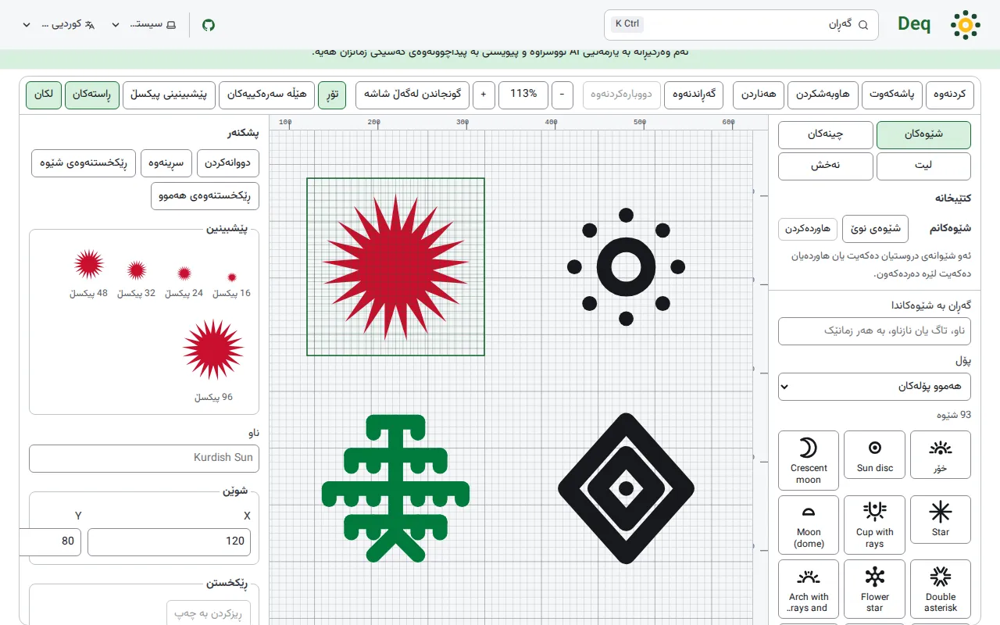

> ئەم دەقە ڕەشنووسە و هێشتا پێویستی بە پێداچوونەوەی ئاخێوەرانی سۆرانی هەیە. ڕاستکردنەوەکان لە [لیستی کێشەکان](https://github.com/kanilabs/deq/issues) بەخێربێن.

[ستۆدیۆ](https://kanilabs.github.io/deq/ckb/studio/) تابلۆیەکە بۆ شێوەکانی دەق. لە وێبگەڕەکەتدا کار دەکات: دیزاینەکانت لەسەر کۆمپیوتەرەکەت دەمێننەوە، مەگەر پاشەکەوتیان بکەیت، هاوبەشیان بکەیت یان هەناردەیان بکەیت.

<picture>
  <source media="(prefers-color-scheme: dark)" srcset="../../../apps/site/public/screens/studio-ckb-dark.webp" />
  
</picture>

## شاشەکە

- **ئامرازەکان** (سەرەوە): **کردنەوە**، **پاشەکەوت**، **هاوبەشکردن** و **هەناردن**؛ **گەڕاندنەوە** و **دووبارەکردنەوە**؛ زووم؛ گۆڕەرەکانی پیشاندان **تۆڕ**، **هێڵە سەرەکییەکان**، **پێشبینینی پیکسڵ**، **ڕاستەکان** و **لکان**؛ و **کورتەڕێکانی تەختەکلیل**.
- **پانێڵی لا**: تابەکانی **شێوەکان** (کتێبخانە و شێوەکانم)، **چینەکان**، **لیت** و **نەخش**.
- **تابلۆ** (ناوەڕاست).
- **پشکنەر**: هەڵبژاردەکانی شێوە هەڵبژێردراوەکان.

لە شاشەی تەسکدا، وەک مۆبایل، پانێڵی لا، تابلۆ و پشکنەر دەبنە تاب.

## زیادکردنی شێوە

لە **شێوەکان**، لە **گەڕان بە شێوەکاندا** بنووسە (هەر ناو، تاگ یان نازناوێک، بە هەر یەک لە سێ زمانەکە) یان **پۆل**ێک هەڵبژێرە. کلیک لە شێوەیەک بکە بۆ زیادکردنی، یان ڕایبکێشە سەر تابلۆ. [شێوەکانم](custom-shapes.md) لە سەرەوەی کتێبخانە ئەو شێوانە دەپارێزێت کە دەیانکێشیت یان هاوردەیان دەکەیت.

## هەڵبژاردن و جووڵاندن

- کلیک لە شێوەیەک بکە بۆ هەڵبژاردنی. Shift و کلیک شێوە زیاد دەکات یان لە هەڵبژاردە لای دەبات. لەسەر باکگراوندی بەتاڵ ڕابکێشە بۆ هەڵبژاردنی هەموو شێوەکانی ناو لاکێشەیەک.
- شێوەی هەڵبژێردراو ڕابکێشە بۆ جووڵاندنی. کلیلەکانی تیر هەڵبژاردە ١ پیکسڵ دەجووڵێنن، Shift و تیر ١٠ پیکسڵ. کاتێک **لکان** چالاکە، شێوەکان بە تۆڕەکەوە دەلکێن.
- سکڕۆڵ بکە بۆ جووڵاندنی دیمەن، یان Space ڕابگرە و ڕابکێشە، یان بە دوگمەی ناوەڕاست یان دوو پەنجە ڕابکێشە. Ctrl و سکڕۆڵ زووم دەکات. **گونجاندن لەگەڵ شاشە** هەموو شێوەکان پیشان دەدات.

## گۆڕینی هەڵبژاردەکان

پشکنەر هەڵبژاردەکانی هەڵبژاردە پیشان دەدات: **ناو**، **شوێن**، و لە ژێر **هەڵبژاردەکان** **قەبارە (پیکسڵ)**، **ڕەنگ**، **ئەستووری هێڵ**، **ئەستووری هێڵی جێگیر**، **پڕکردنەوە**، **ڕوونیی پڕکردنەوە**، **ڕوونیی هێڵ**، **سەری هێڵ**، **پێکگەیشتنی هێڵ**، **قەبارەی خاڵ**، **سووڕانەوە (°)**، **هەڵگێڕانەوەی ئاسۆیی**، **هەڵگێڕانەوەی ستوونی**، **بۆشایی** و **باکگراوند**. شێوەی پارامەتردار (وەک ژمارەی تیشکەکان) **پارامەترەکانی شێوە** پیشان دەدات، و شێوەی چینچین **ڕەنگی چینەکان**. **پێشبینین** شێوەکە لە ١٦ تا ٩٦ پیکسڵ پیشان دەدات.

کاتێک چەند شێوەیەک هەڵبژێردراون، گۆڕانکاری لەسەر هەموویان دەکرێت، و ئەو هەڵبژاردانەی جیاوازن **تێکەڵ** پیشان دەدەن. **ڕێکخستنەوە** لە تەنیشت هەڵبژاردەیەک بنەڕەتەکەی دەگەڕێنێتەوە؛ **ڕێکخستنەوەی شێوە** پارامەترەکانی شێوە و **ڕێکخستنەوەی هەموو** هەموو هەڵبژاردەکان. **دووانەکردن** و **سڕینەوە** لەسەر هەڵبژاردە کار دەکەن.

## ڕێکخستن

کاتێک دوو شێوە یان زیاتر هەڵبژێردراون، **ڕێکخستن** لە پشکنەر ڕیزیان دەکات (چەپ، ناوەڕاستی ئاسۆیی، ڕاست، سەرەوە، ناوەڕاستی ستوونی، خوارەوە)؛ بە سێ یان زیاتر بە ئاسۆیی یان ستوونی دابەشیان دەکات.

- **گرووپکردن** (Ctrl+G) هەڵبژاردە پێکەوە دەجووڵێنێت و هەڵدەبژێرێت؛ **هەڵوەشاندنەوەی گرووپ** (Ctrl+Shift+G) دووبارە جیای دەکاتەوە.
- **ڕیزی چینەکان**: Ctrl+↑ و Ctrl+↓ هەڵبژاردە دەهێننە پێشەوە و دەنێرنە دواوە؛ Shift زیاد بکە بۆ هێنانە سەرەوەی هەموو یان ناردنە ژێرەوەی هەموو.
- **چینەکان** هەموو شێوەکان ڕیز دەکات، سەرەوە یەکەم. هەر ڕیزێک دەتوانێت شێوەکە قوفڵ بکات (هێشتا هەڵدەبژێردرێت، بەڵام ناجووڵێت، ناگۆڕدرێت و ناسڕدرێتەوە)، بیشارێتەوە (شێوەی شاراوە هەناردە ناکرێت) یان بەرەو سەرەوە و خوارەوەی ببات.

## گەڕاندنەوە

**گەڕاندنەوە** و **دووبارەکردنەوە** هەموو گۆڕانکارییەک دەگرنەوە، کردنەوەی دیزاینێک یان بەستەرێکی هاوبەشکراویش. دوایین کردار ڕادەگەیەنرێت، بۆ نموونە «گەڕێندرایەوە: جووڵاندن».

## پاشەکەوت، کردنەوە و هاوبەشکردن

- **پاشەکەوت** دیزاینەکە وەک `deq-design.json` دادەگرێت، لەگەڵ ئەو شێوە تایبەتانەی بەکاری دەهێنێت.
- **کردنەوە** فایلی دیزاین، شێوەیەکی تایبەت (JSON ی spec) یان SVG دەخوێنێتەوە، تا ١ مێگابایت. دیزاین جێگەی تابلۆ دەگرێتەوە (گەڕاندنەوە هی خۆت دەهێنێتەوە)؛ شێوە یان SVG بۆ شێوەکانم زیاد دەکرێت.
- **هاوبەشکردن** بەستەرێک لەبەر دەگرێتەوە کە هەموو دیزاینەکە لە ناونیشانەکەدا، دوای `#`، هەڵدەگرێت. هیچ شتێک بار ناکرێت: بەستەرەکە خۆی دیزاینەکەیە. دیزاینی گەورە لە بەستەرێکدا جێی نابێتەوە؛ وەک فایل پاشەکەوتی بکە.

کارەکەت لە نێوان سەردانەکانیشدا لەم وێبگەڕەدا دەمێنێتەوە. وێبگەڕێک کە ڕێگری لە پاشەکەوتکردن دەکات، شێوەکانم تەنها تا داخستنی پەڕەکە دەهێڵێتەوە.

## کورتەڕێکانی تەختەکلیل

**کورتەڕێکانی تەختەکلیل** هەموو کورتەڕێکان پیشان دەدات و ڕێگەت دەدات بیانگۆڕیت؛ گۆڕانکارییەکانت لەم وێبگەڕەدا هەڵدەگیرێن. لە ماکدا Ctrl دەبێتە ⌘.

| کردار                                                  | کلیلەکان                             |
| ------------------------------------------------------ | ------------------------------------ |
| گەڕاندنەوە، دووبارەکردنەوە                             | Ctrl+Z، Ctrl+Shift+Z یان Ctrl+Y      |
| سڕینەوەی هەڵبژاردە                                     | Delete یان Backspace                 |
| دووانەکردن، هەڵبژاردنی هەموو                           | Ctrl+D، Ctrl+A                       |
| لابردنی هەڵبژاردە                                      | Escape                               |
| کردنەوە، پاشەکەوت، هاوبەشکردن، هەناردن                 | Ctrl+O، Ctrl+S، Ctrl+Shift+S، Ctrl+E |
| جووڵاندن، جووڵاندنی ١٠ پیکسڵ                           | کلیلەکانی تیر، Shift+تیر             |
| نزیککردنەوە، دوورخستنەوە، قەبارەی ڕاستەقینە، گونجاندن  | + یان =، -، 0، 1                     |
| تۆڕ، هێڵە سەرەکییەکان، پێشبینینی پیکسڵ، ڕاستەکان، لکان | G، K، P، R، S                        |
| گرووپکردن، هەڵوەشاندنەوەی گرووپ                        | Ctrl+G، Ctrl+Shift+G                 |
| هێنانە پێشەوە، ناردنە دواوە                            | Ctrl+↑، Ctrl+↓                       |
| هێنانە سەرەوەی هەموو، ناردنە ژێرەوەی هەموو             | Ctrl+Shift+↑، Ctrl+Shift+↓           |
| قوفڵکردن، شاردنەوە                                     | Ctrl+Shift+L، Ctrl+Shift+H           |
| گەڕان لە کتێبخانە، پیشاندانی کورتەڕێکان                | /، ?                                 |

ڕیزکردن و دابەشکردن کلیلی بنەڕەتییان نییە؛ دەتوانیت کلیلیان بدەیتێ.

## دواتر

- [هەناردن](exporting.md)ی دیزاینەکە بە ٢٣ فۆرمات.
- [شێوەی تایبەت](custom-shapes.md)ی خۆت.
