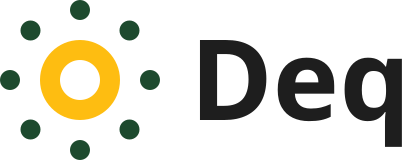
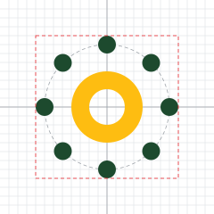
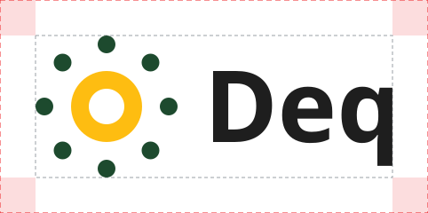

# Brand guide

This is the Deq brand: the logo, the lockups, colours, type, voice and the rules for the flag. The same guide is on the website at [`/brand`](https://kanilabs.github.io/deq/brand/), with the brand kit and the press kit to download. Decisions: [ADR 0013](../decisions/0013-logo-dot-rosette.md) (the logo) and [ADR 0023](../decisions/0023-brand-kit-and-marketing.md) (the kit).

Every file in `assets/brand/` is generated. Change the generators, not the files:

```sh
just brand        # uv run deq-fonts wordmark, then uv run deq-spec brand
just brand-video  # the logo MP4 and WebM in apps/site/public/brand/
```

## The logo

The logo is the Dot rosette from the catalog (`spec/shapes/dot-rosette.json`): eight dots round a ring. The dots are Deq green and the ring is the yellow of the Kurdish sun.

| File                                      | Use                                                                 |
| ----------------------------------------- | ------------------------------------------------------------------- |
| [`logo.svg`](../../assets/brand/logo.svg) | The full logo: the rosette in the Kanî badge                        |
| [`mark.svg`](../../assets/brand/mark.svg) | The rosette alone, for light backgrounds (`mark-dark.svg` for dark) |
| `mark-mono.svg`, `mark-white.svg`         | One colour: `currentColor`, or white on photos and strong colours   |
| `mark-flag.svg`                           | The flag's green and yellow, for Kurdish occasions                  |
| `mark-small.svg`, `favicon.svg`           | 64 px and below: heavier dots and ring, cropped to the mark         |

## Lockups

The wordmark is "Deq" in Noto Sans Bold or "دەق" in Vazirmatn Bold, turned into outlines by `uv run deq-fonts wordmark` (`assets/brand/wordmark.json`). Use the horizontal lockup where there is room and the stacked one in squares. In the Sorani lockups the mark sits on the right, where right-to-left reading starts.

`assets/brand/lockups/` has `{horizontal,stacked}[-ckb]-<way>.svg` in five colourways:

| Way        | Use                                    |
| ---------- | -------------------------------------- |
| `color`    | Light backgrounds                      |
| `reversed` | Dark backgrounds                       |
| `mono`     | Takes the text colour (`currentColor`) |
| `white`    | Photos and strong colours              |
| `flag`     | Kurdish occasions                      |



## Construction and clear space

The rosette sits on the 24-unit shape grid, from 4 to 20. Every distance is a fraction of the mark's diameter D (all values are in [`brand.json`](../../assets/brand/brand.json)):

- Latin cap height 0.5 D; Sorani wordmark height 0.75 D.
- Gap between mark and wordmark 0.25 D, or 0.2 D when stacked.
- Clear space 0.25 D on every side.

 

## Minimum sizes

- Mark: 16 px.
- Horizontal lockup: 120 px wide. Stacked lockup: 64 px wide.
- At 64 px and below, use the small mark (`mark-small.svg`), as the favicon does.

## Colours

The full table, with HEX, RGB, HSL, OKLCH, CMYK and the contrast on white and on Night, is in [brand-colors.md](brand-colors.md); `assets/brand/tokens.css` has the colours as CSS custom properties. The CMYK values are a plain conversion without a colour profile: ask your printer for a proof.

| Colour          | HEX       | Use                                       |
| --------------- | --------- | ----------------------------------------- |
| Deq green       | `#1D4A2E` | Dots of the mark; accent on light         |
| Sun yellow      | `#FEBD11` | Ring of the mark; the flag's sun          |
| Badge face      | `#F8F8F8` | Disc of the badge; light surfaces         |
| Ink             | `#1E1E1E` | Wordmark, badge outline and text on light |
| Deq green, dark | `#8FDBA5` | Dots and accent on dark                   |
| Night           | `#17181C` | Dark surfaces                             |

### Flag and colour rules

- Text and meaning must meet WCAG AA contrast.
- Use only the flag variants listed on the [flag page](../guide/flag.md).
- Never put yellow on white or red on green to carry meaning.

## Typography

The brand uses the site's fonts, all free to use: Noto Sans for Latin text, Vazirmatn for Sorani, and Deq Leet for Leet text.

## Iconography

- Draw on the 24-unit grid and keep 1 unit of padding ([grid and keylines](../designer/grid.md)).
- Change size, colour and stroke width through the render options, never the shapes' geometry.
- Icons take the current text colour unless a colour is set.

## Voice and tone

- **Plain and exact:** say what a thing does, in short sentences.
- **Respectful:** the motifs are a living heritage. Cite sources and never invent a meaning.
- **Kurdish first:** name Sorani and Kurmanji, and keep both scripts.
- **Open:** invite people to use, change and contribute.

## Do and don't

Do:

- Use the files from the brand kit as they are.
- Keep the clear space and the minimum sizes.
- Use the reversed or white lockup on dark backgrounds.

Don't:

- Recolour, stretch, rotate or rearrange the dots and the ring.
- Add shadows, gradients, outlines or other effects.
- Set the wordmark in another font or retype it.
- Put the colour logo on busy photos or low-contrast backgrounds.

## Animated logo

The dots appear clockwise from the top, then the sun ring draws, in 1.7 seconds. It plays once; with reduced motion it shows the still logo. Files: `assets/brand/logo-animated.svg` and `mark-animated.svg` (CSS), and the MP4 and WebM in the brand kit.

## Downloads

| File                                                                      | What                                                                                       |
| ------------------------------------------------------------------------- | ------------------------------------------------------------------------------------------ |
| [Brand kit](https://kanilabs.github.io/deq/brand/deq-brand-kit.zip)       | Every SVG and PNG, the lockups, the favicon pack, the animation, brand.json and tokens.css |
| [Press kit](https://kanilabs.github.io/deq/brand/deq-press-kit.zip)       | A fact sheet, logos, screenshots and the logo video                                        |
| [README banner](https://kanilabs.github.io/deq/brand/banner.png)          | 1280 × 320 PNG, also in light and dark SVG in `assets/brand/`                              |
| [Social preview](https://kanilabs.github.io/deq/brand/social-preview.png) | 1280 × 640 PNG for the GitHub social preview                                               |

Both kits are built with the site from these source files, so they never go stale. The logo and the files are GPL-3.0-or-later; the wordmark outlines come from Noto Sans and Vazirmatn (SIL Open Font License 1.1).
