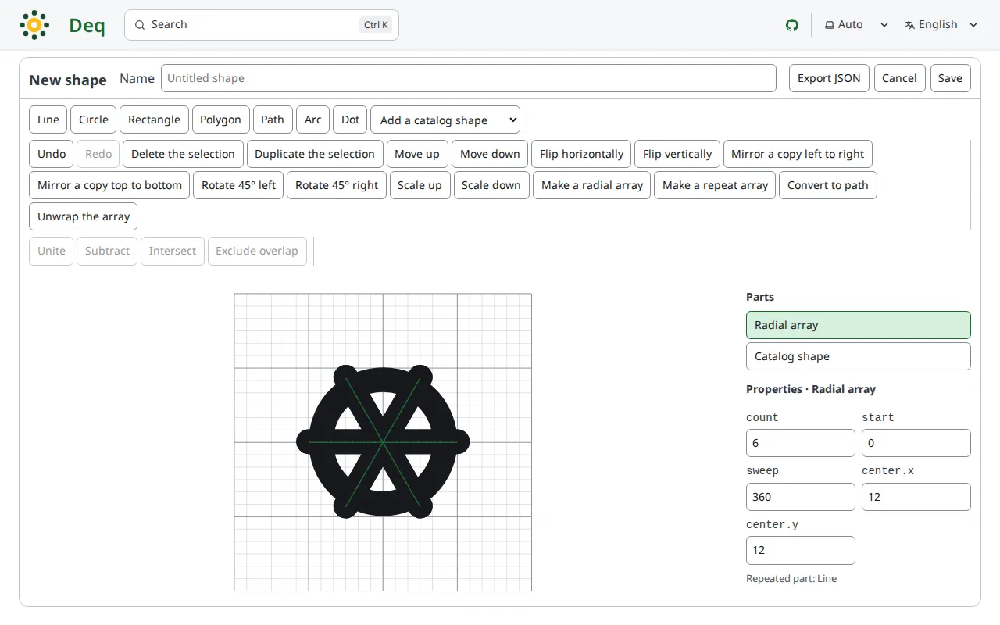

Besides the catalog, the Studio keeps **My shapes**: motifs you draw in the shape editor or import from a file. They work like catalog shapes on the canvas, in the inspector and in every export.

<picture>
  <source media="(prefers-color-scheme: dark)" srcset="../../apps/site/public/screens/shape-editor-en-dark.webp" />
  
</picture>

## Make a shape

1. In the **Shapes** tab, choose **New shape** next to **My shapes**.
2. Give it a **Name**.
3. Add parts with the buttons under **Add part**: **Line**, **Circle**, **Rectangle**, **Polygon**, **Path**, **Arc** and **Dot**. **Add a catalog shape** adds any Deq shape as a part.
4. Drag parts on the grid to move them, or set their numbers under **Properties**. **Paint** chooses **Stroke** or **Fill**.
5. Choose **Save**. The shape appears in My shapes; **Cancel** closes the editor without saving.

The grid is 24 by 24 units, like every Deq shape, and parts must stay inside it. A shape can have up to 64 parts.

## Select and change parts

- Click a part, or its row under **Parts**, to select it. Shift-click selects several; Ctrl+A selects all (⌘ on a Mac).
- The arrow keys move the selection by half a unit, Shift and an arrow by 2 units.
- Ctrl+D duplicates, Delete removes, Ctrl+Z and Ctrl+Shift+Z undo and redo. Escape clears the selection, or closes the editor when nothing is selected.

The shape tools act on the selection:

- **Move up**, **Move down**: the drawing order.
- **Flip horizontally**, **Flip vertically**; **Mirror a copy left to right** and **Mirror a copy top to bottom** add a mirrored copy, which suits the symmetry of most deq motifs.
- **Rotate 45° left**, **Rotate 45° right**, **Scale up**, **Scale down**.
- **Make a radial array** repeats the part around the centre, like the rays of a sun; **Make a repeat array** repeats it in a row. **Unwrap the array** turns an array back into its part.
- **Convert to path** turns a part into a path you can edit point by point.

## Edit a path

Select a path to see its points as handles on the grid. Drag a handle to move it, or click it to select it, then:

- **Add a point after the selected one**,
- **Delete the selected point**,
- **Curve or straighten the segment**,
- **Open or close the path**.

The path data is also shown as text under **Path data**, where you can type or paste it.

## Combine parts

Select two or more closed parts (circles, rectangles, polygons or closed paths) and choose **Unite**, **Subtract**, **Intersect** or **Exclude overlap**. The result is one path. Open parts such as lines cannot be combined.

## Use, export and delete

- Click a shape in My shapes, or drag it, to add it to the canvas.
- The buttons on each shape edit it (✎), download it as spec JSON (⤓) or delete it (✕). Placed copies follow the saved version. Designs that use a deleted shape keep their own copy.
- **Import** reads spec JSON files, such as one exported from here or a file from `spec/shapes/` in the repository.

My shapes is saved in this browser and holds up to 100 shapes. Saved designs and share links carry the custom shapes they use, so they open on any computer.

## Import an SVG

**Open** in the toolbar reads an SVG file (up to 256 KB) and adds it to My shapes. The Studio rebuilds the drawing from its shapes and paths, and leaves out everything else: gradients, text, images, filters, scripts and links. A notice says when something was left out. Very detailed drawings may be refused.

For the best result, draw on a 24 × 24 artboard with strokes and simple fills.

## Next

- [Exporting](exporting.md) your shapes.
- To propose a shape for the catalog, export it as spec JSON and open an [issue](https://github.com/kanilabs/deq/issues) with its source.
