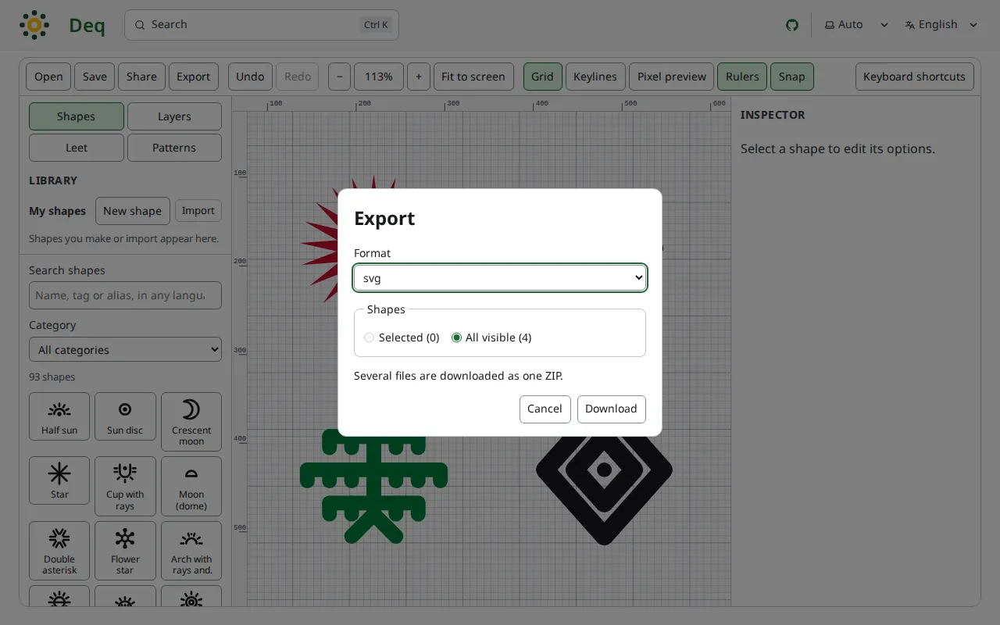

**Export** in the Studio toolbar (Ctrl+E, or ⌘E on a Mac) downloads the shapes on the canvas in any of 23 formats. Each shape is exported with the options you gave it in the inspector.

<picture>
  <source media="(prefers-color-scheme: dark)" srcset="../../apps/site/public/screens/studio-export-en-dark.webp" />
  
</picture>

## Steps

1. Select the shapes to export, or none to export them all.
2. Choose **Export**, then a **Format**.
3. Under **Shapes**, choose **Selected** or **All visible**. Hidden shapes are never exported.
4. For PNG, JPG, WebP, AVIF and PSD, tick one or more **Scales** (1× to 4×).
5. Choose **Download**.

Each shape becomes its own file, named after the shape's **Name** in the inspector, or its id (`kurdish-sun.svg`). A second shape with the same name gets a number (`kurdish-sun-2.svg`). Several files download together as `deq-export.zip`. Larger scales add `@2x`, `@3x` and so on to the name.

## Formats

| Group      | Format               | What you get                                                                                               |
| ---------- | -------------------- | ---------------------------------------------------------------------------------------------------------- |
| **Vector** | SVG                  | The shape as a small SVG file.                                                                             |
|            | Layered SVG          | An SVG with one Inkscape layer per shape layer.                                                            |
|            | SVG sprite           | `deq-sprite.svg`, one `<symbol>` per shape, for `<use>` references.                                        |
|            | PDF                  | A vector PDF; shapes with layers keep them as PDF layers.                                                  |
|            | AI                   | A PDF-compatible Illustrator file with the same layers.                                                    |
|            | EPS                  | EPS 3.0 for older print workflows.                                                                         |
| **Raster** | PNG, JPG, WebP, AVIF | Images at each scale. JPG has a white background.                                                          |
|            | ICO                  | A Windows icon with 16, 32 and 48 px images.                                                               |
|            | Favicon              | A favicon set for a website: `favicon.ico`, `favicon.svg`, Apple and Android icons and `site.webmanifest`. |
|            | PSD                  | A Photoshop file with one pixel layer per shape layer.                                                     |
| **Code**   | HTML                 | An inline SVG snippet.                                                                                     |
|            | JSX, TSX             | A React component.                                                                                         |
|            | Vue, Svelte          | A single-file component.                                                                                   |
|            | Data URI             | The SVG as a `data:` URL in a text file.                                                                   |
|            | CSS background       | A CSS class with the SVG as `background-image`.                                                            |
|            | CSS mask             | A CSS class that masks with the SVG, so the shape takes the text colour.                                   |
| **Data**   | Figma                | An SVG with named groups and fixed colours, ready to import into Figma.                                    |
|            | Spec JSON            | The shape in Deq's own format, to open again in the Studio or add to the catalog.                          |

Formats that take one square shape (SVG sprite, ICO, favicon, Figma and spec JSON) are not offered for Leet text and patterns, which are exported as one scene. See [Deq Leet](leet.md) and [Pattern generator](generate.md).

## Opening the files

- **Inkscape** 1.4 and later shows the layers of layered SVG, PDF and AI files.
- **Illustrator** opens AI and PDF files with one layer per shape layer.
- **Photoshop** opens PSD files with one pixel layer per shape layer.
- **Figma**: import the Figma SVG, or paste an SVG.

## Offline

PNG, JPG, WebP, AVIF, ICO, favicon and PSD files are drawn by a WebAssembly module that loads on the first raster export. It is not stored for offline use, so raster exports need a connection. See [Install and offline use](pwa.md).

## Without the Studio

The `deq` command line for Node.js and the `@0xdolan/deq-exporters` package make the same files; the Python and Rust tools export SVG, layered SVG, SVG sprites, PDF, PNG, JPG, WebP and ICO. See [Command line](../dev/cli.md) and [Packages](../dev/packages.md).
