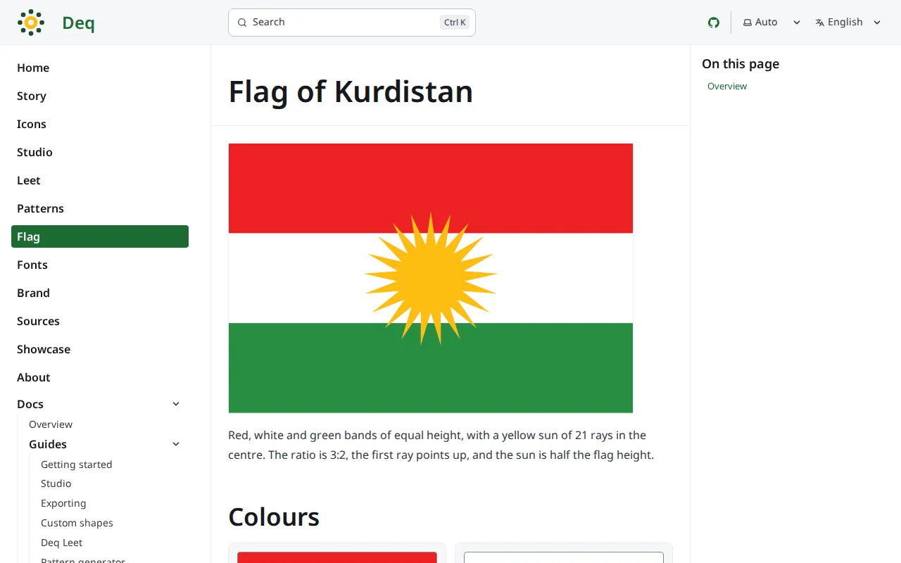

The [Flag](https://kanilabs.github.io/deq/flag/) page draws the flag of Kurdistan from its specification: red, white and green bands of equal height, and a yellow sun of 21 rays in the centre. The ratio is 3:2, the first ray points up, and the sun is half the flag's height.

<picture>
  <source media="(prefers-color-scheme: dark)" srcset="../../apps/site/public/screens/flag-en-dark.webp" />
  
</picture>

## On the page

- **Colours**: red, white, green and yellow, each in hex, RGB and CMYK.
- **Contrast**: the contrast ratio of every pair of flag colours. No pair reaches the 4.5:1 that body text needs, so put black or white text on the flag colours.
- **Variants**: full colour, mono black, mono white, outline, high contrast and square.

Never recolour, stretch or change the number of rays of the flag.

## Get the flag

- **Studio**: search for "flag" in the [Studio](studio.md) library, add the Flag of Kurdistan to the canvas and [export](exporting.md) it in any format.
- **Command line**: `deq flag` writes the flag as SVG, PNG, JPG or WebP.

  ```sh
  deq flag --variant outline --width 1200 --format png --out flag.png
  ```

  `--variant` is one of `full-color`, `mono-black`, `mono-white`, `outline`, `high-contrast` and `square`; `--width` is 1 to 8192 pixels (900 by default). See [Command line](../dev/cli.md).

- **Code**: `renderFlag({ variant, width, title })` in `@0xdolan/deq-core` returns the SVG. See [Packages](../dev/packages.md).

The specification, with its sources, is in [`spec/flag.json`](../../spec/flag.json).
