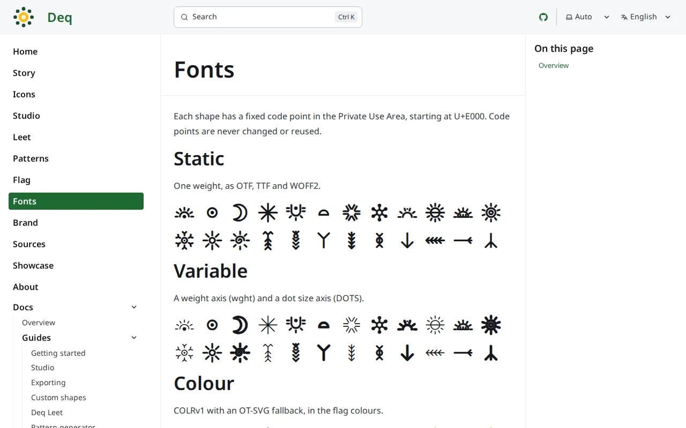

Deq comes with two font families. **Deq Icons** has every shape as a glyph, in a static, a variable and a colour version. **Deq Leet** writes letters as Deq motifs. The [Fonts](https://kanilabs.github.io/deq/fonts/) page shows them with a live specimen.

<picture>
  <source media="(prefers-color-scheme: dark)" srcset="../../apps/site/public/screens/fonts-en-dark.webp" />
  
</picture>

## Which font

- **Static**: one weight, as OTF, TTF and WOFF2. Works everywhere.
- **Variable**: a weight axis (`wght`) and a dot size axis (`DOTS`), for apps that support variable fonts.
- **Colour**: COLRv1 in the flag colours, with an OT-SVG fallback.
- **Deq Leet**: a monospaced text font for Latin, Kurmanji and Sorani, with alternative glyphs in the stylistic sets `ss01` to `ss03`. See [Deq Leet](leet.md).

Install either the static or the variable Deq Icons, not both, so apps don't list the family twice.

## Download

The fonts are released as `deq-fonts-<version>.zip` on the [releases page](https://github.com/kanilabs/deq/releases). Until the first release, build them from the repository with `just fonts`; they are written to `fonts/dist/`.

## Install

- **Linux**: copy the `.otf` or `.ttf` files to `~/.local/share/fonts/` and run `fc-cache -f`. Check with `fc-list | grep "Deq"`.
- **macOS**: double-click a font file and choose **Install Font** in Font Book, or copy the files to `~/Library/Fonts/`.
- **Windows**: right-click the font files and choose **Install** (or **Install for all users**).

Restart apps that were open, so they see the new fonts.

## Type a shape

- **By name**: in apps that support ligatures (such as Figma, Illustrator, Inkscape and LibreOffice), type a shape's id (`roj-half-sun`), an alias, or its Kurmanji name in ASCII (`roj`, `heyv`) in Deq Icons and it becomes the glyph.
- **By code point**: every shape has a code point from U+E000, shown on its icon page as **Font code point** and listed in [`codepoints.md`](../fonts/codepoints.md). Code points never change.
- **Deq Leet**: type normal text. **Copy font text** on the [Leet page](https://kanilabs.github.io/deq/leet/) copies text that keeps the exact glyphs of the preview.

## On a website

The release zip also has `deq-icons.css`, `deq-leet.css` and the code point maps (`codepoints.json`, `leet-codepoints.json`). How to use them on a page, and how the fonts are built, is in the [font guide](../fonts/README.md).

## Licence

The fonts are licensed under GPL-3.0-or-later with the Font Exception, so documents that embed them need not be GPL. See [`fonts/LICENSE.md`](../../fonts/LICENSE.md).
