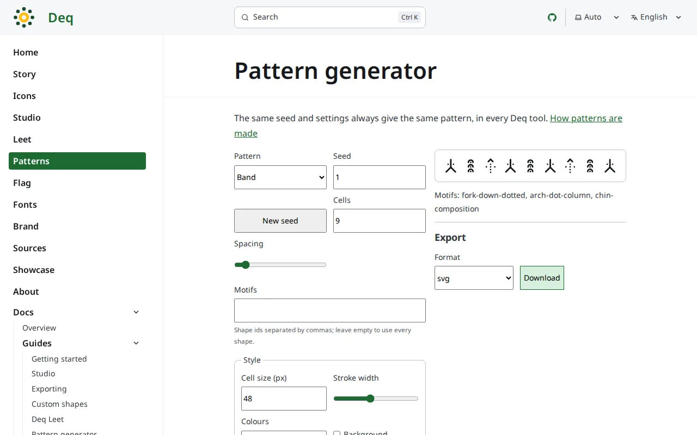

The pattern generator arranges Deq motifs from a seed. The same seed and settings always give the same pattern, in the website, the packages and the three command-line tools.

<picture>
  <source media="(prefers-color-scheme: dark)" srcset="../../apps/site/public/screens/generate-en-dark.webp" />
  
</picture>

## Kinds

- **Band**: a row of an odd number of cells (3 to 63), mirrored around the centre.
- **Grid**: columns and rows (1 to 32 each).
- **Rosette**: 3 to 24 petals rotated around a centre motif.
- **Border**: a frame of motifs, 3 to 32 cells a side.

**Spacing** adds grid units between cells. **Motifs** limits the pattern to the shape ids you list, separated by commas or spaces. Leave it empty to use every shape. The page lists the motifs a pattern used.

## The pattern page

The [pattern page](https://kanilabs.github.io/deq/generate/) previews the pattern with the same style options as the Leet page and downloads it in every format that fits a scene, with one layer per cell. **New seed** picks a random seed. Write it down to make the same pattern again.

## In the Studio

The **Patterns** tab in the [Studio](https://kanilabs.github.io/deq/studio/) adds the pattern to the canvas as one group with an item per cell.

## In code and on the command line

```ts
import { pattern } from "@0xdolan/deq-generator";

const { svg, motifs } = pattern({ kind: "rosette", petals: 12, seed: 7 });
```

```sh
deq generate --kind rosette --petals 12 --seed 7 --out rosette.svg
```
