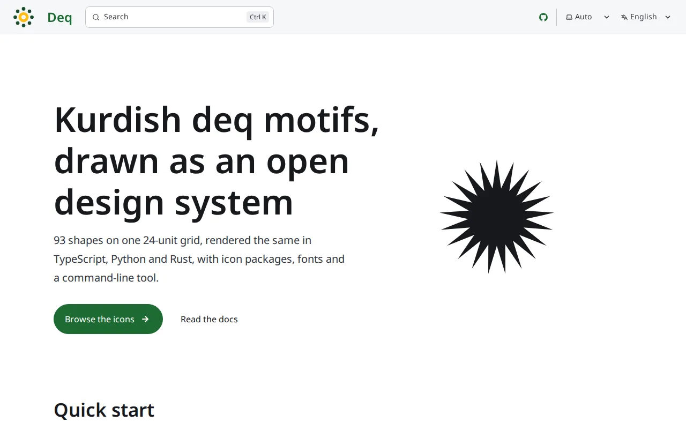
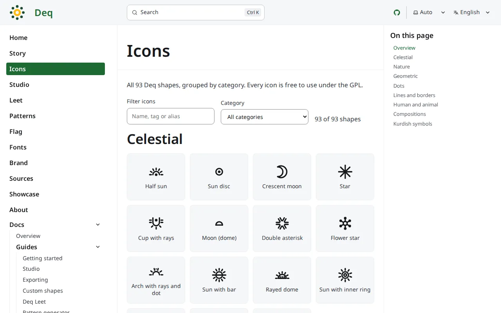
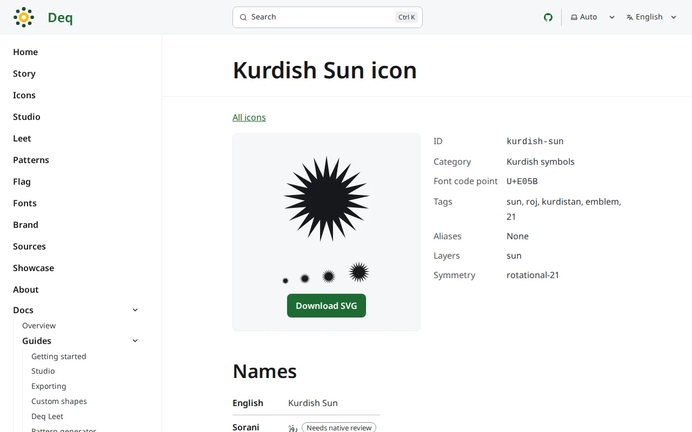

Deq turns traditional Kurdish tattoo motifs (deq) into open icons, fonts and tools. Everything on the site is free to use under GPL-3.0-or-later; the fonts add the Font Exception. This guide shows where to start.

<picture>
  <source media="(prefers-color-scheme: dark)" srcset="../../apps/site/public/screens/home-en-dark.webp" />
  
</picture>

## Find a motif

Open [Icons](https://kanilabs.github.io/deq/icons/) to see every shape. Type in **Filter icons** to search by English, Kurmanji or Sorani name, tag or alias, or choose a **Category**. The search field at the top (Ctrl+K, or ⌘K on a Mac) searches the whole site, guides included.

<picture>
  <source media="(prefers-color-scheme: dark)" srcset="../../apps/site/public/screens/icons-en-dark.webp" />
  
</picture>

Each shape has its own page with a preview, its names in three languages, its tags, parameters and font code point, a **Download SVG** button and a **Usage** example.

<picture>
  <source media="(prefers-color-scheme: dark)" srcset="../../apps/site/public/screens/icon-en-dark.webp" />
  
</picture>

## Use it in a project

- **Copy the SVG.** **Download SVG** saves the shape at its default options. To change size, colour or stroke first, open it in the [Studio](studio.md).
- **In code.** The **Usage** example shows the React component and the `<deq-icon>` element. The packages for React, Vue, Svelte, web components, Python and Rust are listed in [Packages](../dev/packages.md).
- **As a font.** Install the icon font and type the shape's name or code point. See [Fonts](fonts.md).
- **Many formats.** The Studio exports PNG, PDF, AI, PSD, JSX and 17 more formats. See [Exporting](exporting.md).

## Make something

- [Studio](studio.md): place, combine and style shapes on a canvas.
- [Custom shapes](custom-shapes.md): draw your own motif from parts and paths, or import an SVG.
- [Deq Leet](leet.md): write text with Deq motifs.
- [Pattern generator](generate.md): make bands, grids, rosettes and borders from a seed.
- [Flag](flag.md): the flag of Kurdistan from its specification.

## Language, theme and offline use

- The language menu at the top switches between English, Sorani (کوردی) and Kurmanji (Kurdî). Sorani pages run right to left.
- The theme menu chooses dark, light or your system's setting (**Auto**).
- The site works offline once it has loaded. See [Install and offline use](pwa.md).

The Sorani and Kurmanji texts are drafts that still need review by native speakers. Corrections are welcome in the [issue tracker](https://github.com/kanilabs/deq/issues).
