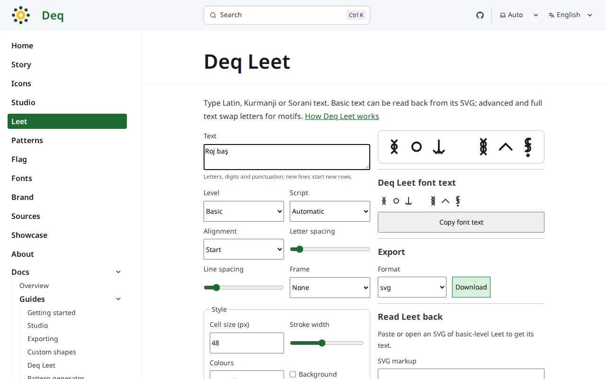

Deq Leet writes each letter, digit and punctuation mark as a Deq motif. It covers Latin, Kurmanji and Sorani. Sorani lines run right to left.

<picture>
  <source media="(prefers-color-scheme: dark)" srcset="../../apps/site/public/screens/leet-en-dark.webp" />
  
</picture>

## Levels

- **Basic**: one readable glyph per character. Basic text can be read back from its SVG.
- **Advanced**: the seed picks between the basic glyph and its alternatives, so the same seed always gives the same text.
- **Full**: one decorative motif per character. It is not meant to be read.

## The Leet page

Type text on the [Leet page](https://kanilabs.github.io/deq/leet/). The preview follows every change.

- **Script**: automatic detection, or force Latin and Kurmanji, or Sorani.
- **Letter spacing** and **line spacing** are in grid units (24 units are one glyph). **Alignment** follows the reading direction.
- **Frame**: none, a band of motifs above and below, or a border around the text. The frame seed picks its motifs.
- **Style**: cell size, stroke width, and the text colour, one colour or the flag colours in turn. A background colour is optional.
- **Show line guides** draws the top and bottom of every line. The guides are never exported.
- **Copy font text** copies the text as private-use characters of the [Deq Leet font](https://kanilabs.github.io/deq/fonts/). Pasted where the font is used, it shows exactly the glyphs of the preview, alternatives included.
- **Download** exports in every format that fits a scene, with one layer per character in layered SVG, PDF, AI and PSD. ICO, favicon, sprite, Figma and spec JSON are not offered.
- **Read Leet back** takes basic-level SVG, pasted or from a file, and gives its text.

Input is plain text, at most 1,024 characters, 256 glyphs and 32 lines. Characters without a glyph are left out and listed.

## In the Studio

The **Leet** tab in the [Studio](https://kanilabs.github.io/deq/studio/) has the same controls. **Add to canvas** inserts the text as one group with an item per character, which you can move, recolour and edit like any other item. A glyph built from several motifs becomes a custom shape of the design.

## In code and on the command line

```ts
import { decodeLeet, leet } from "@0xdolan/deq-generator";

const { svg, unknown } = leet("Roj baş", { level: "advanced", seed: 42 });
decodeLeet(leet("Deq").svg).text; // "DEQ"
```

```sh
deq leet "Roj baş" --level advanced --seed 42 --out roj.svg
```

The Python and Rust ports give the same SVG for the same options. Frames and the font text are features of the website.
