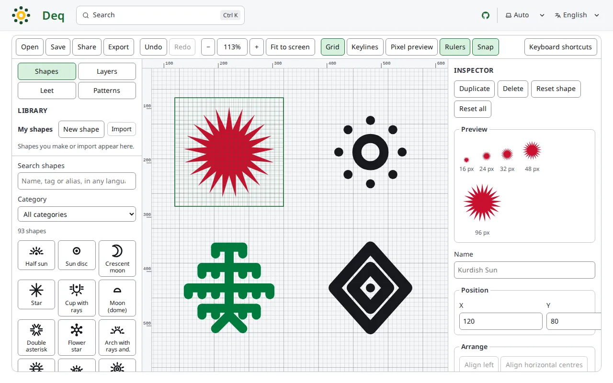

The [Studio](https://kanilabs.github.io/deq/studio/) is a canvas for Deq shapes. It runs in your browser: designs stay on your computer unless you save, share or export them.

<picture>
  <source media="(prefers-color-scheme: dark)" srcset="../../apps/site/public/screens/studio-en-dark.webp" />
  
</picture>

## The screen

- **Toolbar** (top): **Open**, **Save**, **Share** and **Export**; **Undo** and **Redo**; zoom; the view switches **Grid**, **Keylines**, **Pixel preview**, **Rulers** and **Snap**; and **Keyboard shortcuts**.
- **Side panel** (left): the tabs **Shapes** (the library and My shapes), **Layers**, **Leet** and **Patterns**.
- **Canvas** (middle).
- **Inspector** (right): the options of the selected shapes.

On a narrow screen, such as a phone, the side panel, canvas and inspector become tabs.

## Add shapes

In **Shapes**, type in **Search shapes** (any name, tag or alias, in any of the three languages) or choose a **Category**. Click a shape to add it, or drag it onto the canvas. [My shapes](custom-shapes.md) at the top of the library holds the shapes you draw or import.

## Select and move

- Click a shape to select it. Shift-click adds or removes shapes from the selection. Drag on the empty background to select every shape in a rectangle.
- Drag a selected shape to move it. The arrow keys nudge the selection by 1 px, Shift and an arrow by 10 px. With **Snap** on, shapes snap to the grid.
- Scroll to pan, or hold Space and drag, or drag with the middle button or two fingers. Ctrl and scroll zooms. **Fit to screen** shows every shape.

## Change options

The inspector shows the options of the selection: **Name**, **Position**, and under **Options** the **Size (px)**, **Colour**, **Stroke width**, **Absolute stroke width**, **Fill**, **Fill opacity**, **Stroke opacity**, **Line cap**, **Line join**, **Dot scale**, **Rotation (°)**, **Flip horizontally**, **Flip vertically**, **Padding** and **Background**. Shapes with parameters (such as the number of rays) show **Shape parameters**, and shapes with layers show **Layer colours**. **Preview** shows the shape at 16 to 96 px.

With several shapes selected, a change applies to all of them, and options that differ show **Mixed**. **Reset** next to an option restores its default; **Reset shape** restores the shape's parameters and **Reset all** every option. **Duplicate** and **Delete** act on the selection.

## Arrange

With two or more shapes selected, **Arrange** in the inspector aligns them (left, horizontal centres, right, top, vertical centres, bottom); with three or more it distributes them horizontally or vertically.

- **Group** (Ctrl+G) makes the selection move and select together; **Ungroup** (Ctrl+Shift+G) splits it again.
- **Layer order**: Ctrl+↑ and Ctrl+↓ move the selection forward and backward; add Shift to bring it to the front or send it to the back.
- **Layers** lists every shape, top first. Each row can lock the shape (it can still be selected, but not moved, changed or deleted), hide it (hidden shapes are not exported) or move it up and down.

## Undo

**Undo** and **Redo** cover every change, including opening a design or a share link. The last action is announced, for example "Undone: Move".

## Save, open and share

- **Save** downloads the design as `deq-design.json`, with the custom shapes it uses.
- **Open** reads a design file, a custom shape (spec JSON) or an SVG, up to 1 MB. A design replaces the canvas (Undo brings yours back); a shape or SVG is added to My shapes.
- **Share** copies a link that holds the whole design in the address, after the `#`. Nothing is uploaded: the link itself is the design. Large designs do not fit in a link; save them as a file instead.

Your work is also kept in this browser between visits. A browser that blocks storage keeps My shapes only until you close the page.

## Keyboard shortcuts

**Keyboard shortcuts** lists every shortcut and lets you change it; your changes are saved in this browser. Ctrl is ⌘ on a Mac.

| Action                                      | Keys                                 |
| ------------------------------------------- | ------------------------------------ |
| Undo, redo                                  | Ctrl+Z, Ctrl+Shift+Z or Ctrl+Y       |
| Delete the selection                        | Delete or Backspace                  |
| Duplicate, select all                       | Ctrl+D, Ctrl+A                       |
| Clear the selection                         | Escape                               |
| Open, save, share, export                   | Ctrl+O, Ctrl+S, Ctrl+Shift+S, Ctrl+E |
| Nudge, move 10 px                           | Arrow keys, Shift+arrow keys         |
| Zoom in, out, actual size, fit              | + or =, -, 0, 1                      |
| Grid, keylines, pixel preview, rulers, snap | G, K, P, R, S                        |
| Group, ungroup                              | Ctrl+G, Ctrl+Shift+G                 |
| Forward, backward                           | Ctrl+↑, Ctrl+↓                       |
| To front, to back                           | Ctrl+Shift+↑, Ctrl+Shift+↓           |
| Lock, hide                                  | Ctrl+Shift+L, Ctrl+Shift+H           |
| Search the library, show shortcuts          | /, ?                                 |

Align and distribute have no default keys; you can give them some.

## Next

- [Exporting](exporting.md) the design in 23 formats.
- [Custom shapes](custom-shapes.md) of your own.
