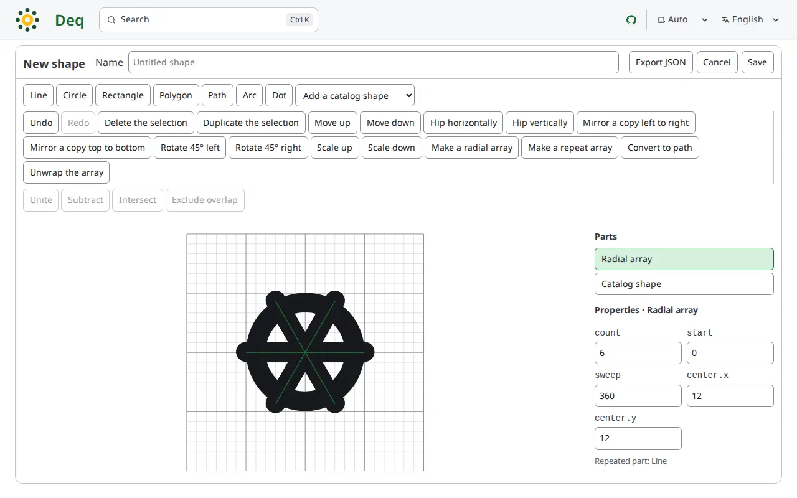

> Ev nivîs pêşnûmeyek e û hîn divê axêverên kurmancî lê binêrin. Rastkirin di [lîsteya pirsgirêkan](https://github.com/kanilabs/deq/issues) de bi xêr hatin.

Ji bilî katalogê, Stûdyo **Şiklên min** digire: motîfên ku tu di edîtora şiklan de xêz dikî an ji pelekî tînî. Ew li ser kanvasê, di kontrolkerê de û di her derxistinê de wek şiklên katalogê dixebitin.

<picture>
  <source media="(prefers-color-scheme: dark)" srcset="../../../apps/site/public/screens/shape-editor-en-dark.webp" />
  
</picture>

## Şiklekî çêke

1. Di taba **Şikl** de, li kêleka **Şiklên min** **Şiklê nû** hilbijêre.
2. **Nav**ekî bide wî.
3. Bi bişkokên di bin **Beşê lê zêde bike** de beşan lê zêde bike: **Xet**, **Xelek**, **Çargoşe**, **Pirgoşe**, **Rêç**, **Kevan** û **Xal**. **Şiklekî ji katalogê lê zêde bike** her şiklekî Deqê wek beşekê lê zêde dike.
4. Beşan li ser torê bikişîne da ku wan bilivînî, an hejmarên wan di bin **Taybetmendî** de deyne. **Boyax** **Xet** an **Dagirtin** hildibijêre.
5. **Tomar bike** hilbijêre. Şikl di Şiklên min de xuya dibe; **Betal bike** edîtorê bê tomarkirin digire.

Tor 24 bi 24 yekîne ye, wek her şiklekî Deqê, û divê beş di hundirê wê de bimînin. Şiklek dikare heta 64 beşan hebe.

## Beşan hilbijêre û biguherîne

- Li beşekê, an rêza wê di bin **Beş** de, bitikîne da ku wê hilbijêrî. Shift û tikandin çendan hildibijêre; Ctrl+A hemûyan (li Macê ⌘).
- Bişkojkên tîran hilbijartinê nîv yekîne dilivînin, Shift û tîr 2 yekîne.
- Ctrl+D ducar dike, Delete jê dibe, Ctrl+Z û Ctrl+Shift+Z vedigerînin û dîsa dikin. Escape hilbijartinê paqij dike, an dema tiştek hilbijartî nebe edîtorê digire.

Amûrên şiklî li ser hilbijartinê dixebitin:

- **Ber bi jor**, **Ber bi jêr**: rêza xêzkirinê.
- **Asoyî bizivirîne**, **Stûnî bizivirîne**; **Kopiyeke neynikî ji çep ber bi rast** û **Kopiyeke neynikî ji jor ber bi jêr** kopiyeke neynikî lê zêde dikin, ku li hevsengiya piraniya motîfên deqê tê.
- **45° ber bi çep bizivirîne**, **45° ber bi rast bizivirîne**, **Mezin bike**, **Biçûk bike**.
- **Rêzeke dorhêlî çêke** beşê li dora navendê dubare dike, wek tîrêjên rojê; **Rêzeke dubare çêke** wê di rêzekê de dubare dike. **Rêzê veke** rêzê dîsa dike beşa wê.
- **Bike rêç** beşekê dike rêçeke ku xal bi xal tê guhertin.

## Rêçekê biguherîne

Rêçekê hilbijêre da ku xalên wê wek destikan li ser torê bibînî. Destikekê bikişîne da ku bilivînî, an lê bitikîne da ku hilbijêrî, paşê:

- **Piştî xala hilbijartî xalekê lê zêde bike**,
- **Xala hilbijartî jê bibe**,
- **Perçeyê bitewîne an rast bike**,
- **Rêçê veke an bigire**.

Daneyên rêçê wek nivîs jî di bin **Daneyên rêçê** de tên nîşandan, ku tu dikarî tê de binivîsî an bizeliqînî.

## Beşan bike yek

Du an zêdetir beşên girtî hilbijêre (xelek, çargoşe, pirgoşe an rêçên girtî) û **Yek bike**, **Jê derxe**, **Hevbirrîn** an **Hevbeşê derxe** hilbijêre. Encam yek rêç e. Beşên vekirî wek xetan nayên yekkirin.

## Bikaranîn, derxistin û jêbirin

- Li şiklekî di Şiklên min de bitikîne, an wî bikişîne, da ku li kanvasê zêde bibe.
- Bişkokên li ser her şiklî wî diguherînin (✎), wek spec JSON dadixin (⤓) an jê dibin (✕). Kopiyên danî li pey guhertoya tomarkirî diçin. Sêwiranên ku şiklekî jêbirî bi kar tînin kopiya xwe diparêzin.
- **Bîne** pelên spec JSON dixwîne, wek yekî ku ji vir hatiye derxistin an pelekî ji `spec/shapes/` a depoyê.

Şiklên min di vê gerokê de tê tomarkirin û heta 100 şiklan digire. Sêwiranên tomarkirî û girêdanên parvekirî şiklên taybet ên ku bi kar tînin bi xwe re dibin, ji ber vê li ser her komputerê vedibin.

## SVGyekê bîne

**Veke** di amûran de pelekî SVG (heta 256 KB) dixwîne û li Şiklên min zêde dike. Stûdyo xêzkirinê ji şikl û rêçên wê dîsa ava dike û her tiştê din derdixe: gradyan, nivîs, wêne, fîlter, skrîpt û girêdan. Agahdariyek dibêje kengî tiştek hatiye derxistin. Xêzkirinên pir hûrgilî dibe ku werin redkirin.

Ji bo encama herî baş, li ser rûpelekî 24 × 24 bi xet û dagirtinên sade xêz bike.

## Pişt re

- Şiklên xwe [derxe](exporting.md).
- Ji bo pêşniyarkirina şiklekî ji katalogê re, wî wek spec JSON derxe û bi çavkaniya wî [pirsgirêkekê](https://github.com/kanilabs/deq/issues) veke.
