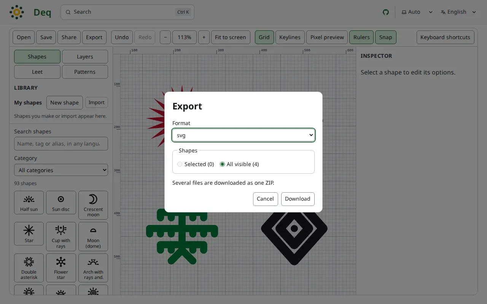

> Ev nivîs pêşnûmeyek e û hîn divê axêverên kurmancî lê binêrin. Rastkirin di [lîsteya pirsgirêkan](https://github.com/kanilabs/deq/issues) de bi xêr hatin.

**Derxe** di amûrên Stûdyoyê de (Ctrl+E, an ⌘E li Macê) şiklên li ser kanvasê bi her yek ji 23 formatan dadixe. Her şikl bi vebijarkên ku te di kontrolkerê de dane wî tê derxistin.

<picture>
  <source media="(prefers-color-scheme: dark)" srcset="../../../apps/site/public/screens/studio-export-en-dark.webp" />
  
</picture>

## Gav

1. Şiklên ku dixwazî derxînî hilbijêre, an tu şiklî hilnebijêre da ku hemû werin derxistin.
2. **Derxe** hilbijêre, paşê **Format**ekê.
3. Di bin **Şikil** de, **Hilbijartî** an **Hemû yên xuya** hilbijêre. Şiklên veşartî qet nayên derxistin.
4. Ji bo PNG, JPG, WebP, AVIF û PSD, yek an çend **Pîvan** (1× heta 4×) nîşan bike.
5. **Daxe** hilbijêre.

Her şikl dibe pelekî cuda, bi **Nav**ê şiklî di kontrolkerê de, an nasnameya wî (`kurdish-sun.svg`). Şiklê duyem bi heman navî hejmarekê distîne (`kurdish-sun-2.svg`). Çend pel bi hev re wek `deq-export.zip` tên daxistin. Pîvanên mezintir `@2x`, `@3x` û hwd li navî zêde dikin.

## Format

| Kom        | Format               | Tu çi distînî                                                                                           |
| ---------- | -------------------- | ------------------------------------------------------------------------------------------------------- |
| **Vektor** | SVG                  | Şikl wek pelekî SVG yê biçûk.                                                                           |
|            | Layered SVG          | SVGyek bi qatekî Inkscape ji bo her qatekî şiklî.                                                       |
|            | SVG sprite           | `deq-sprite.svg`, yek `<symbol>` ji bo her şiklî, ji bo referansên `<use>`.                             |
|            | PDF                  | PDFa vektor; şiklên bi qat wan wek qatên PDFê diparêzin.                                                |
|            | AI                   | Pelekî Illustrator yê bi PDFê re lihevhatî, bi heman qatan.                                             |
|            | EPS                  | EPS 3.0 ji bo rêyên çapê yên kevntir.                                                                   |
| **Raster** | PNG, JPG, WebP, AVIF | Wêne bi her pîvanê. JPG paşxaneyeke spî heye.                                                           |
|            | ICO                  | Îkoneke Windowsê bi wêneyên 16, 32 û 48 px.                                                             |
|            | Favicon              | Komek favîkon ji bo malperê: `favicon.ico`, `favicon.svg`, îkonên Apple û Android û `site.webmanifest`. |
|            | PSD                  | Pelekî Photoshop bi qatekî pîkselan ji bo her qatekî şiklî.                                             |
| **Kod**    | HTML                 | Perçeyek SVG ya di rêzê de.                                                                             |
|            | JSX, TSX             | Pêkhateyeke React.                                                                                      |
|            | Vue, Svelte          | Pêkhateyeke yek-pelî.                                                                                   |
|            | Data URI             | SVG wek girêdaneke `data:` di pelekî nivîsê de.                                                         |
|            | CSS background       | Çîneke CSS bi SVGê wek `background-image`.                                                              |
|            | CSS mask             | Çîneke CSS ku bi SVGê maske dike, ji ber vê şikl rengê nivîsê digire.                                   |
| **Dane**   | Figma                | SVGyek bi komên navdar û rengên sabît, amade ji bo anîna nav Figmayê.                                   |
|            | Spec JSON            | Şikl bi formata Deqê ya xwe, ji bo dîsa vekirinê di Stûdyoyê de an zêdekirina li katalogê.              |

Formatên ku tenê yek şiklê çargoşe digirin (SVG sprite, ICO, favîkon, Figma û spec JSON) ji bo nivîsa Leetê û nexşan nayên pêşkêşkirin, ku wek yek dîmen tên derxistin. Binêre [Deq Leet](leet.md) û [Çêkerê nexşan](generate.md).

## Vekirina pelan

- **Inkscape** 1.4 û nûtir qatên Layered SVG, PDF û AI nîşan dide.
- **Illustrator** pelên AI û PDF bi qatekî ji bo her qatekî şiklî vedike.
- **Photoshop** pelên PSD bi qatekî pîkselan ji bo her qatekî şiklî vedike.
- **Figma**: SVGa Figmayê bîne, an SVGyekê bizeliqîne.

## Bê înternet

Pelên PNG, JPG, WebP, AVIF, ICO, favîkon û PSD bi modûleke WebAssembly tên xêzkirin ku di derxistina rasterê ya yekem de bar dibe. Ew ji bo bikaranîna bê înternet nayê tomarkirin, ji ber vê derxistina rasterê înternetê dixwaze. Binêre [Sazkirin û bikaranîna bê înternet](pwa.md).

## Bê Stûdyo

Fermana `deq` ji bo Node.js û pakêta `@0xdolan/deq-exporters` heman pelan çêdikin; amûrên Python û Rust SVG, Layered SVG, SVG sprite, PDF, PNG, JPG, WebP û ICO derdixin. Binêre [Rêza fermanê](../../dev/cli.md) û [Pakêt](../../dev/packages.md).
