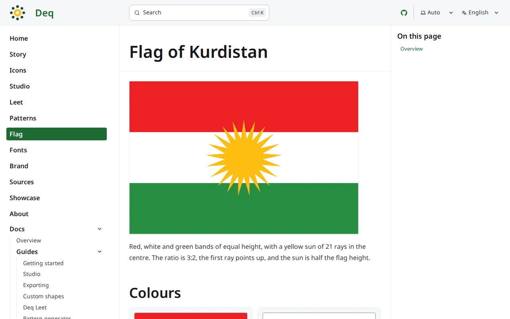

> Ev nivîs pêşnûmeyek e û hîn divê axêverên kurmancî lê binêrin. Rastkirin di [lîsteya pirsgirêkan](https://github.com/kanilabs/deq/issues) de bi xêr hatin.

Rûpela [Ala](https://kanilabs.github.io/deq/kmr/flag/) alaya Kurdistanê li gorî taybetnameya wê xêz dike: sê bendên sor, spî û kesk bi bilindahiya wekhev, û rojeke zer bi 21 tîrêjan di navendê de. Rêje 3:2 ye, tîrêja yekem ber bi jor e, û roj nîvê bilindahiya alayê ye.

<picture>
  <source media="(prefers-color-scheme: dark)" srcset="../../../apps/site/public/screens/flag-en-dark.webp" />
  
</picture>

## Li ser rûpelê

- **Reng**: sor, spî, kesk û zer, her yek bi hex, RGB û CMYK.
- **Kontrast**: rêjeya kontrastê ya her cotek ji rengên alayê. Tu cot nagihîje 4.5:1 ku nivîsa asayî dixwaze, ji ber vê nivîsa reş an spî li ser rengên alayê deyne.
- **Guherto**: rengê tevahî, reşa yekreng, spiya yekreng, xêza derve, kontrasta bilind û çargoşe.

Qet rengê alayê neguherîne, wê dirêj neke û hejmara tîrêjan neguherîne.

## Alayê bistîne

- **Stûdyo**: di pirtûkxaneya [Stûdyo](studio.md)yê de li «flag» an «ala» bigere, **Alaya Kurdistanê** li kanvasê zêde bike û bi her formatê [derxe](exporting.md).
- **Rêza fermanê**: `deq flag` alayê wek SVG, PNG, JPG an WebP dinivîse.

  ```sh
  deq flag --variant outline --width 1200 --format png --out flag.png
  ```

  `--variant` yek ji `full-color`, `mono-black`, `mono-white`, `outline`, `high-contrast` û `square` e; `--width` ji 1 heta 8192 pîksel e (bi standard 900). Binêre [Rêza fermanê](../../dev/cli.md).

- **Kod**: `renderFlag({ variant, width, title })` di `@0xdolan/deq-core` de SVGê vedigerîne. Binêre [Pakêt](../../dev/packages.md).

Taybetname, bi çavkaniyên wê, di [`spec/flag.json`](../../../spec/flag.json) de ye.
