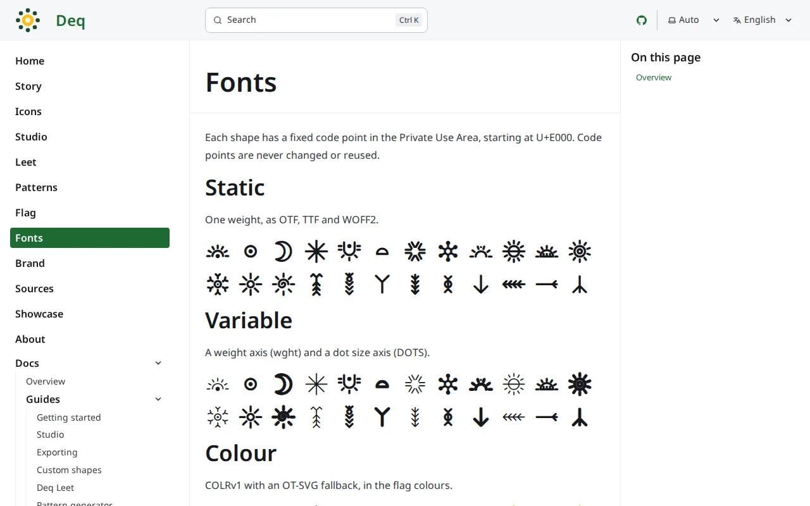

> Ev nivîs pêşnûmeyek e û hîn divê axêverên kurmancî lê binêrin. Rastkirin di [lîsteya pirsgirêkan](https://github.com/kanilabs/deq/issues) de bi xêr hatin.

Deq bi du malbatên fontan tê. **Deq Icons** her şiklî wek glîfekê digire, bi guhertoyeke sabît, guhêrbar û rengîn. **Deq Leet** tîpan wek motîfên Deqê dinivîse. Rûpela [Font](https://kanilabs.github.io/deq/kmr/fonts/) wan bi nimûneyeke zindî nîşan dide.

<picture>
  <source media="(prefers-color-scheme: dark)" srcset="../../../apps/site/public/screens/fonts-en-dark.webp" />
  
</picture>

## Kîjan font

- **Sabît**: yek stûrî, wek OTF, TTF û WOFF2. Li her derê dixebite.
- **Guhêrbar**: axeke stûriyê (`wght`) û axeke mezinahiya xalan (`DOTS`), ji bo bernameyên ku fontên guhêrbar piştgirî dikin.
- **Rengîn**: COLRv1 bi rengên alayê, bi OT-SVG wek alternatîf.
- **Deq Leet**: fonteke nivîsê ya yekfireh ji bo latînî, kurmancî û soranî, bi glîfên alternatîf di komên şêwazê `ss01` heta `ss03` de. Binêre [Deq Leet](leet.md).

Yan Deq Icons a sabît yan a guhêrbar saz bike, ne herduyan, da ku bername malbatê du caran lîste nekin.

## Daxistin

Font wek `deq-fonts-<version>.zip` li [rûpela weşanan](https://github.com/kanilabs/deq/releases) tên weşandin. Heta weşana yekem, wan ji depoyê bi `just fonts` ava bike; ew di `fonts/dist/` de tên nivîsandin.

## Sazkirin

- **Linux**: pelên `.otf` an `.ttf` li `~/.local/share/fonts/` kopî bike û `fc-cache -f` bixebitîne. Bi `fc-list | grep "Deq"` kontrol bike.
- **macOS**: du caran li pelekî fontê bitikîne û di Font Bookê de **Install Font** hilbijêre, an pelan li `~/Library/Fonts/` kopî bike.
- **Windows**: li pelên fontê rast-bitikîne û **Install** (an **Install for all users**) hilbijêre.

Bernameyên ku vekirî bûn ji nû ve veke, da ku fontên nû bibînin.

## Şiklekî binivîse

- **Bi navî**: di bernameyên ku ligature piştgirî dikin de (wek Figma, Illustrator, Inkscape û LibreOffice), nasnameya şiklekî (`roj-half-sun`), navekî din, an navê wî yê kurmancî bi ASCII (`roj`, `heyv`) bi Deq Icons binivîse û ew dibe glîf.
- **Bi xala kodê**: her şiklî xaleke kodê ji U+E000 heye, ku li rûpela îkona wî wek **Xala kodê ya fontê** tê nîşandan û di [`codepoints.md`](../../fonts/codepoints.md) de lîstekirî ye. Xalên kodê qet naguherin.
- **Deq Leet**: nivîsa asayî binivîse. **Nivîsa fontê kopî bike** li [rûpela Leetê](https://kanilabs.github.io/deq/kmr/leet/) nivîsekê kopî dike ku tam glîfên pêşdîtinê diparêze.

## Li ser malperekê

Zipa weşanê `deq-icons.css`, `deq-leet.css` û nexşeyên xalên kodê (`codepoints.json`, `leet-codepoints.json`) jî digire. Çawa wan li rûpelekê bi kar bînî, û font çawa tên avakirin, di [rêbera fontan](../../fonts/README.md) de ye (bi îngilîzî).

## Lîsans

Font bi GPL-3.0-or-later û Font Exception lîsanskirî ne, ji ber vê belgeyên ku wan tê de bicih dikin ne mecbûr in GPL bin. Binêre [`fonts/LICENSE.md`](../../../fonts/LICENSE.md).
