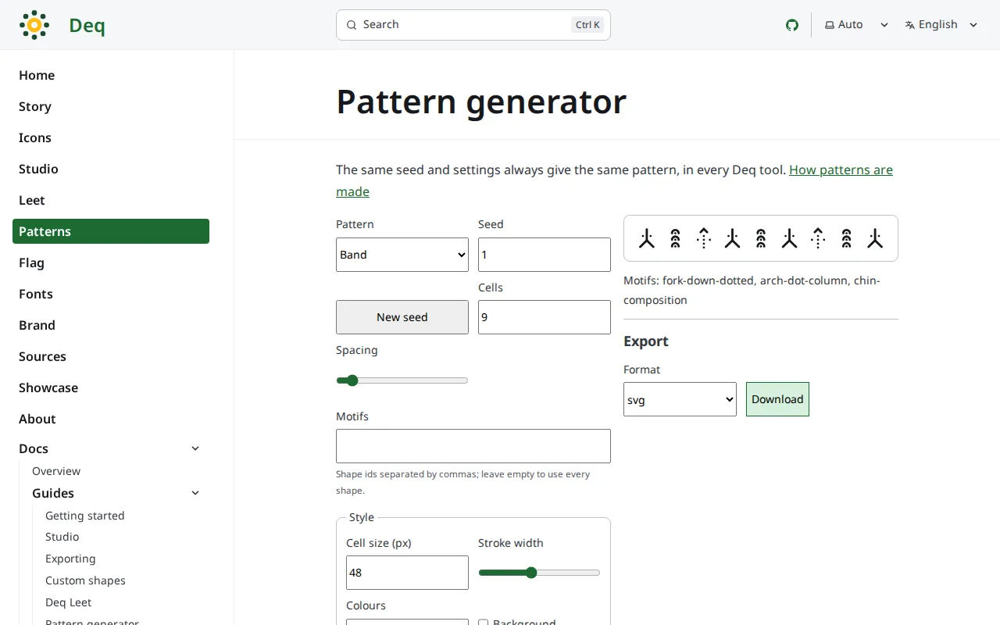

> Ev nivîs pêşnûmeyek e û hîn divê axêverên kurmancî lê binêrin. Rastkirin di [lîsteya pirsgirêkan](https://github.com/kanilabs/deq/issues) de bi xêr hatin.

Çêkerê nexşan motîfên Deqê ji tovekê rêz dike. Heman tov û mîheng her tim heman nexşê didin, li malperê, di pakêtan de û di her sê amûrên rêza fermanê de.

<picture>
  <source media="(prefers-color-scheme: dark)" srcset="../../../apps/site/public/screens/generate-en-dark.webp" />
  
</picture>

## Cure

- **Bend**: rêzek ji hejmareke kit a xaneyan (3 heta 63), li dora navendê neynikî.
- **Tor**: stûn û rêz (her yek 1 heta 32).
- **Gulok**: 3 heta 24 pel ku li dora motîfeke navendî dizivirin.
- **Kenar**: çarçoveyek ji motîfan, her alî 3 heta 32 xane.

**Navber** yekîneyên torê dixe navbera xaneyan. **Motîf** nexşê bi nasnameyên şiklan ên ku tu dinivîsî sînor dike, bi bêhnok an valahiyan veqetandî. Vala bihêle da ku hemû şikl bên bikaranîn. Rûpel motîfên ku nexşê bi kar anîne lîste dike.

## Rûpela nexşan

[Rûpela nexşan](https://kanilabs.github.io/deq/kmr/generate/) nexşê bi heman vebijarkên şêwazê yên rûpela Leetê nîşan dide û bi hemû formatên ku li dîmenekê tên dadixe, bi qatekî ji bo her xaneyê. **Tovê nû** tovekî rasthatî hildibijêre. Wî binivîse da ku heman nexşê dîsa çêkî.

## Di Stûdyoyê de

Taba **Nexş** di [Stûdyo](https://kanilabs.github.io/deq/kmr/studio/)yê de nexşê wek yek kom bi hêmanekê ji bo her xaneyê li kanvasê zêde dike.

## Di kodê de û li rêza fermanê

```ts
import { pattern } from "@0xdolan/deq-generator";

const { svg, motifs } = pattern({ kind: "rosette", petals: 12, seed: 7 });
```

```sh
deq generate --kind rosette --petals 12 --seed 7 --out rosette.svg
```
