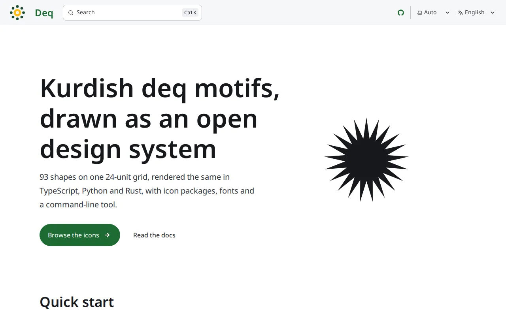
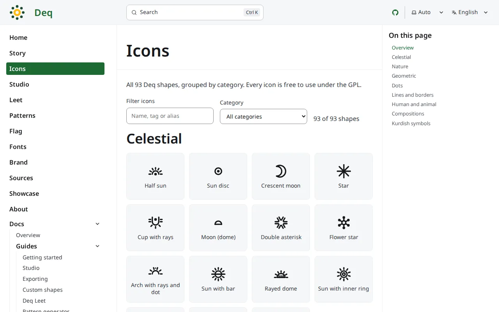
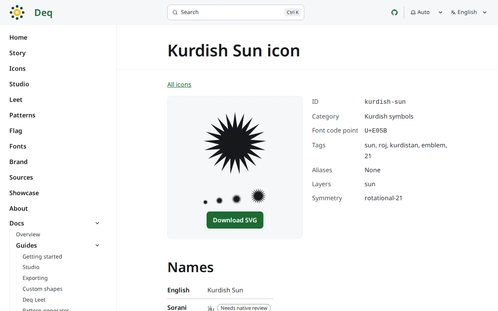

> Ev nivîs pêşnûmeyek e û hîn divê axêverên kurmancî lê binêrin. Rastkirin di [lîsteya pirsgirêkan](https://github.com/kanilabs/deq/issues) de bi xêr hatin.

Deq motîfên kevneşopî yên deqa kurdî dike îkon, font û amûrên vekirî. Her tiştê li malperê bi lîsansa GPL-3.0-or-later belaş e; fontan «Font Exception» jî heye. Ev rêber nîşan dide ku ji ku dest pê bikî.

<picture>
  <source media="(prefers-color-scheme: dark)" srcset="../../../apps/site/public/screens/home-en-dark.webp" />
  
</picture>

## Motîfekê bibîne

[Îkon](https://kanilabs.github.io/deq/kmr/icons/) veke da ku hemû şiklan bibînî. Di **Îkonan parzûn bike** de binivîse da ku bi navê îngilîzî, kurmancî an soranî, etîket an navê din bigerî, an **Kategorî**yekê hilbijêre. Qada lêgerînê ya li jor (Ctrl+K, an ⌘K li Macê) li hemû malperê digere, rêber jî tê de.

<picture>
  <source media="(prefers-color-scheme: dark)" srcset="../../../apps/site/public/screens/icons-en-dark.webp" />
  
</picture>

Her şiklî rûpela xwe heye: pêşdîtin, navên wî bi sê zimanan, etîket, parametre û **Xala kodê ya fontê**, bişkoka **SVG daxe** û mînakeke **Bikaranîn**ê.

<picture>
  <source media="(prefers-color-scheme: dark)" srcset="../../../apps/site/public/screens/icon-en-dark.webp" />
  
</picture>

## Di projeyekê de bi kar bîne

- **SVGê kopî bike.** **SVG daxe** şiklî bi vebijarkên standard tomar dike. Ji bo guhertina mezinahî, reng an stûriya xetê, pêşî wî di [Stûdyo](studio.md)yê de veke.
- **Di kodê de.** Mînaka **Bikaranîn**ê pêkhateya React û hêmana `<deq-icon>` nîşan dide. Pakêtên React, Vue, Svelte, web components, Python û Rust di [Pakêt](../../dev/packages.md)an de ne.
- **Wek font.** Fonta îkonan saz bike û navê şiklî an xala kodê ya wî binivîse. Binêre [Font](fonts.md).
- **Gelek format.** Stûdyo PNG, PDF, AI, PSD, JSX û 17 formatên din derdixe. Binêre [Derxistin](exporting.md).

## Tiştekî çêke

- [Stûdyo](studio.md): şiklan li ser kanvasekê deyne, bike yek û şêwaz bide wan.
- [Şiklên taybet](custom-shapes.md): motîfa xwe ji beş û rêçan xêz bike, an SVGyekê bîne.
- [Deq Leet](leet.md): nivîsê bi motîfên Deqê binivîse.
- [Çêkerê nexşan](generate.md): ji tovekê bend, tor, gulok û kenaran çêke.
- [Ala](flag.md): ala Kurdistanê li gorî taybetnameya wê.

## Ziman, tema û bikaranîna bê înternet

- Menûya zimên li jor di navbera îngilîzî, soranî (کوردی) û kurmancî (Kurdî) de diguhere. Rûpelên soranî ji rast ber bi çep in.
- Menûya temayê tarî, ronî an mîhengê pergala te hildibijêre.
- Malper piştî barkirina yekem bê înternet jî dixebite. Binêre [Sazkirin û bikaranîna bê înternet](pwa.md).
