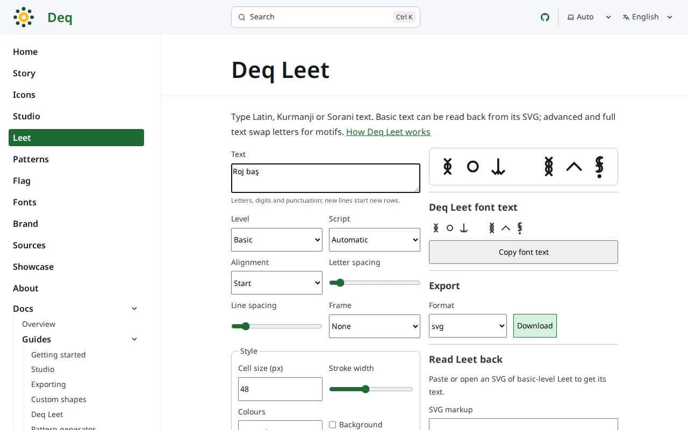

> Ev nivîs pêşnûmeyek e û hîn divê axêverên kurmancî lê binêrin. Rastkirin di [lîsteya pirsgirêkan](https://github.com/kanilabs/deq/issues) de bi xêr hatin.

Deq Leet her tîp, hejmar û nîşaneya xalbendiyê wek motîfeke Deqê dinivîse. Ew latînî, kurmancî û soranî digire. Rêzên soranî ji rast ber bi çep in.

<picture>
  <source media="(prefers-color-scheme: dark)" srcset="../../../apps/site/public/screens/leet-en-dark.webp" />
  
</picture>

## Ast

- **Bingehîn**: ji bo her karakterekê glîfeke xwendinbar. Nivîsa bingehîn ji SVGya xwe dikare paşve were xwendin.
- **Pêşketî**: tov di navbera glîfa bingehîn û alternatîfên wê de hildibijêre, ji ber vê heman tov her tim heman nivîsê dide.
- **Tevahî**: ji bo her karakterekê motîfeke xemilandinê. Ne ji bo xwendinê ye.

## Rûpela Leetê

Li [rûpela Leetê](https://kanilabs.github.io/deq/kmr/leet/) nivîsê binivîse. Pêşdîtin li pey her guhertinê diçe.

- **Alfabe**: naskirina xweber, an bi zorê latînî û kurmancî, an soranî.
- **Navbera tîpan** û **Navbera rêzan** bi yekîneyên torê ne (24 yekîne glîfek e). **Rêzkirin** li pey rêya xwendinê diçe.
- **Çarçove**: tune, bendek ji motîfan li jor û jêr, an kenarek li dora nivîsê. **Tovê çarçoveyê** motîfên wê hildibijêre.
- **Şêwaz**: mezinahiya xaneyê, firehiya xêzê, û rengê nivîsê, yek reng an rengên alayê bi dorê. Rengê paşxaneyê bijarte ye.
- **Rêberên rêzê nîşan bide** jor û jêrê her rêzê xêz dike. Rêber qet nayên derxistin.
- **Nivîsa fontê kopî bike** nivîsê wek karakterên bikaranîna taybet ên [fonta Deq Leet](https://kanilabs.github.io/deq/kmr/fonts/) kopî dike. Li cihê ku font tê bikaranîn bizeliqîne, ew tam glîfên pêşdîtinê nîşan dide, alternatîf jî.
- **Daxe** bi hemû formatên ku li dîmenekê tên derdixe, bi qatekî ji bo her karakterekê di Layered SVG, PDF, AI û PSD de. ICO, favîkon, sprite, Figma û spec JSON nayên pêşkêşkirin.
- **Leetê paşve bixwîne** SVGya asta bingehîn, zeliqandî an ji pelekî, distîne û nivîsa wê dide.

Ketin nivîsa sade ye, herî zêde 1.024 karakter, 256 glîf û 32 rêz. Karakterên bê glîf tên derxistin û lîstekirin.

## Di Stûdyoyê de

Taba **Leet** di [Stûdyo](https://kanilabs.github.io/deq/kmr/studio/)yê de heman kontrolan heye. **Li kanvasê zêde bike** nivîsê wek yek kom bi hêmanekê ji bo her karakterekê datîne, ku tu dikarî wek her hêmaneke din bilivînî, rengê wê biguherînî û biguherînî. Glîfeke ku ji çend motîfan pêk tê dibe şiklekî taybet ê sêwiranê.

## Di kodê de û li rêza fermanê

```ts
import { decodeLeet, leet } from "@0xdolan/deq-generator";

const { svg, unknown } = leet("Roj baş", { level: "advanced", seed: 42 });
decodeLeet(leet("Deq").svg).text; // "DEQ"
```

```sh
deq leet "Roj baş" --level advanced --seed 42 --out roj.svg
```

Portên Python û Rust ji bo heman vebijarkan heman SVGê didin. Çarçove û nivîsa fontê taybetmendiyên malperê ne.
