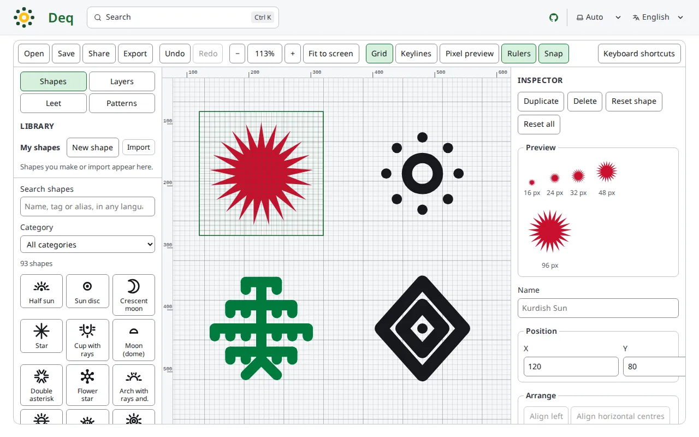

> Ev nivîs pêşnûmeyek e û hîn divê axêverên kurmancî lê binêrin. Rastkirin di [lîsteya pirsgirêkan](https://github.com/kanilabs/deq/issues) de bi xêr hatin.

[Stûdyo](https://kanilabs.github.io/deq/kmr/studio/) kanvasek e ji bo şiklên Deqê. Di geroka te de dixebite: sêwiranên te li ser komputera te dimînin, heta ku tu wan tomar nekî, parve nekî an dernexî.

<picture>
  <source media="(prefers-color-scheme: dark)" srcset="../../../apps/site/public/screens/studio-en-dark.webp" />
  
</picture>

## Ekran

- **Amûr** (jor): **Veke**, **Tomar bike**, **Parve bike** û **Derxe**; **Vegerîne** û **Dîsa bike**; zoom; guhêrbarên dîtinê **Tor**, **Xetên sereke**, **Pêşdîtina pîkselan**, **Rêxêz** û **Pêvegirtin**; û **Kurteriyên klavyeyê**.
- **Panela kêlekê** (çep): tabên **Şikl** (pirtûkxane û Şiklên min), **Qat**, **Leet** û **Nexş**.
- **Kanvas** (navîn).
- **Kontrolker** (rast): vebijarkên şiklên hilbijartî.

Li ser ekraneke teng, wek telefonê, panela kêlekê, kanvas û kontrolker dibin tab.

## Şiklan lê zêde bike

Di **Şikl** de, di **Li şiklan bigere** de binivîse (her nav, etîket an navê din, bi her yek ji sê zimanan) an **Kategorî**yekê hilbijêre. Li şiklekî bitikîne da ku lê zêde bibe, an wî bikişîne ser kanvasê. [Şiklên min](custom-shapes.md) li serê pirtûkxaneyê şiklên ku tu xêz dikî an tînî digire.

## Hilbijartin û livandin

- Li şiklekî bitikîne da ku wî hilbijêrî. Shift û tikandin şiklan li hilbijartinê zêde dike an jê derdixe. Li ser paşxaneya vala bikişîne da ku hemû şiklên di çargoşeyekê de hilbijêrî.
- Şiklê hilbijartî bikişîne da ku wî bilivînî. Bişkojkên tîran hilbijartinê 1 px dilivînin, Shift û tîr 10 px. Dema **Pêvegirtin** vekirî be, şikl bi torê ve dizeliqin.
- Ji bo livandina dîtinê scroll bike, an Space bigire û bikişîne, an bi bişkoka navîn an du tiliyan bikişîne. Ctrl û scroll zoom dike. **Li ekranê bicih bike** hemû şiklan nîşan dide.

## Vebijarkan biguherîne

Kontrolker vebijarkên hilbijartinê nîşan dide: **Nav**, **Cih**, û di bin **Vebijark** de **Mezinahî (px)**, **Reng**, **Stûriya xetê**, **Stûriya xetê ya mutleq**, **Dagirtin**, **Zelaliya dagirtinê**, **Zelaliya xetê**, **Serê xetê**, **Girêka xetê**, **Pîvana xalan**, **Zivirîn (°)**, **Horizontal bizivirîne**, **Vertîkal bizivirîne**, **Valahî** û **Paşxane**. Şiklên bi parametre (wek hejmara tîrêjan) **Parametreyên şiklê** nîşan didin, û şiklên bi qat **Rengên qatan**. **Pêşdîtin** şiklî ji 16 heta 96 px nîşan dide.

Dema çend şikl hilbijartî bin, guhertin li hemûyan tê kirin, û vebijarkên cuda **Tevlihev** nîşan didin. **Vegerîne destpêkê** li kêleka vebijarkekê nirxa standard vedigerîne; **Şiklê vegerîne destpêkê** parametreyên şiklî û **Hemûyan vegerîne destpêkê** hemû vebijarkan. **Ducar bike** û **Jê bibe** li ser hilbijartinê dixebitin.

## Rêzkirin

Dema du an zêdetir şikl hilbijartî bin, **Rêzkirin** di kontrolkerê de wan hevrêz dike (çep, navendên asoyî, rast, jor, navendên stûnî, jêr); bi sê an zêdetir wan asoyî an stûnî belav dike.

- **Kom bike** (Ctrl+G) hilbijartinê bi hev re dilivîne û hildibijêre; **Komê veqetîne** (Ctrl+Shift+G) wê dîsa ji hev vediqetîne.
- **Rêza qatan**: Ctrl+↑ û Ctrl+↓ hilbijartinê pêşve dibin û paşve dibin; Shift lê zêde bike da ku bibe herî pêş an herî paş.
- **Qat** hemû şiklan rêz dike, yê jorîn pêşî. Her rêz dikare şiklî kilît bike (hîn tê hilbijartin, lê nayê livandin, guhertin an jêbirin), veşêre (şiklên veşartî nayên derxistin) an ber bi jor û jêr bibe.

## Vegerandin

**Vegerîne** û **Dîsa bike** her guhertinê digirin, vekirina sêwiranekê an girêdaneke parvekirî jî. Çalakiya dawî tê ragihandin, mînak «Hate vegerandin: Livandin».

## Tomar bike, veke û parve bike

- **Tomar bike** sêwiranê wek `deq-design.json` dadixe, bi şiklên taybet ên ku bi kar tîne.
- **Veke** pelê sêwiranê, şiklekî taybet (JSON a spec) an SVG dixwîne, heta 1 MB. Sêwiran cihê kanvasê digire (Vegerîne ya te vedigerîne); şikl an SVG li Şiklên min tê zêdekirin.
- **Parve bike** girêdanekê kopî dike ku hemû sêwiranê di navnîşanê de, piştî `#`, digire. Tiştek nayê barkirin: girêdan bi xwe sêwiran e. Sêwiranên mezin di girêdanekê de cih nagirin; wan wek pel tomar bike.

Karê te di navbera serdanan de jî di vê gerokê de dimîne. Gerokeke ku tomarkirinê asteng dike, Şiklên min tenê heta girtina rûpelê digire.

## Kurteriyên klavyeyê

**Kurteriyên klavyeyê** hemû kurteriyan nîşan dide û dihêle tu wan biguherînî; guhertinên te di vê gerokê de tên tomarkirin. Li Macê Ctrl dibe ⌘.

| Çalakî                                                   | Bişkojk                              |
| -------------------------------------------------------- | ------------------------------------ |
| Vegerîne, dîsa bike                                      | Ctrl+Z, Ctrl+Shift+Z an Ctrl+Y       |
| Hilbijartinê jê bibe                                     | Delete an Backspace                  |
| Ducar bike, hemûyan hilbijêre                            | Ctrl+D, Ctrl+A                       |
| Hilbijartinê paqij bike                                  | Escape                               |
| Veke, tomar bike, parve bike, derxe                      | Ctrl+O, Ctrl+S, Ctrl+Shift+S, Ctrl+E |
| Hinekî bilivîne, 10 px bilivîne                          | Bişkojkên tîran, Shift+tîr           |
| Nêzîk bike, dûr bike, mezinahiya rastîn, bicih bike      | + an =, -, 0, 1                      |
| Tor, xetên sereke, pêşdîtina pîkselan, rêxêz, pêvegirtin | G, K, P, R, S                        |
| Kom bike, komê veqetîne                                  | Ctrl+G, Ctrl+Shift+G                 |
| Pêşve bîne, paşve bibe                                   | Ctrl+↑, Ctrl+↓                       |
| Bibe herî pêş, bibe herî paş                             | Ctrl+Shift+↑, Ctrl+Shift+↓           |
| Kilît bike, veşêre                                       | Ctrl+Shift+L, Ctrl+Shift+H           |
| Li pirtûkxaneyê bigere, kurteriyan nîşan bide            | /, ?                                 |

Hevrêzkirin û belavkirin bişkojkên standard tune ne; tu dikarî bidî wan.

## Pişt re

- Sêwiranê bi 23 formatan [derxe](exporting.md).
- [Şiklên taybet](custom-shapes.md) ên xwe.
